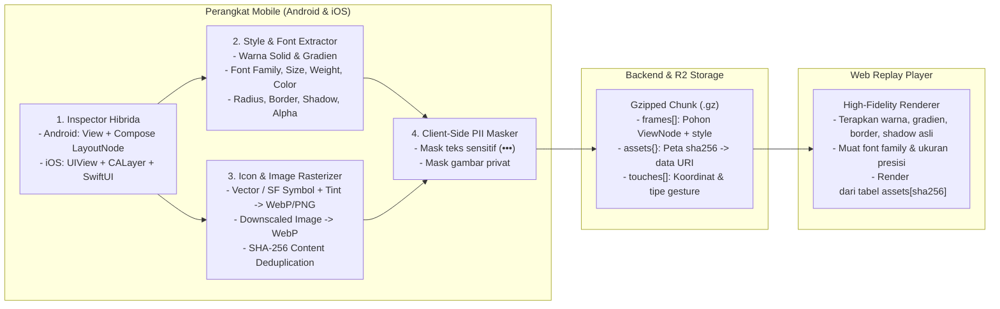
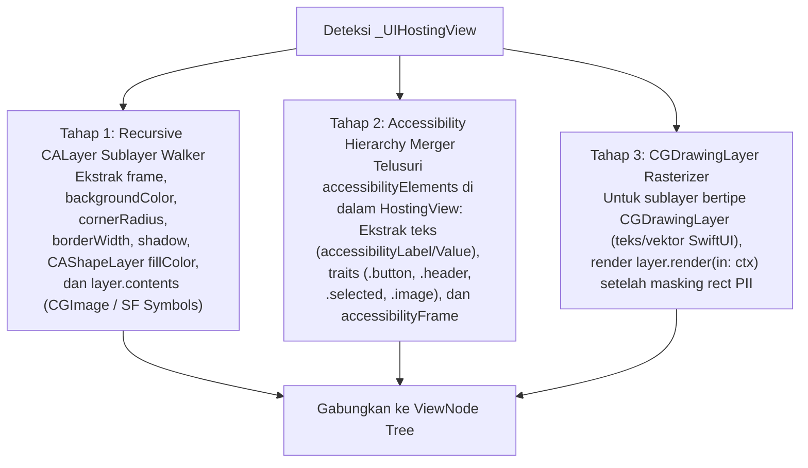

# Blueprint & Rencana Implementasi: 100% High-Fidelity Mobile Session Replay (Android XML/Compose & iOS UIKit/SwiftUI)

> **Dokumen**: Arsitektur & Rencana Implementasi Lintas Platform (Android, iOS, & Web Renderer)  
> **Cakupan Platform**:
> - **Android (`artracker-android`)**: Android View System (**XML**) & **Jetpack Compose**
> - **iOS (`artracker-ios`)**: **UIKit** & **SwiftUI**
> - **Web Player (`artracker/frontend`)**: High-Fidelity Visual Renderer  
> **Tujuan Utama**: Membawa seluruh properti visual asli dari aplikasi mobile—**warna (background, teks, tint, gradien, border)**, **tipografi (font family, ukuran, ketebalan/weight, perataan, line-height)**, **gambar & icon vektor (`VectorDrawable`, `ImageVector`, SF Symbols, Bitmap)**, serta **elevasi/shadow & corner radius**—agar tampilan Session Replay di Web Dashboard **100% identik dengan layar aplikasi asli** seperti halnya Web Session Replay, tetap hemat bandwidth, dan aman terhadap privasi (client-side PII masking).

---

## 1. Mengapa Mobile Replay Sebelumnya Kehilangan Warna & Icon?

Berbeda dengan Web Browser yang memiliki DOM HTML, CSS Stylesheet, dan tag `<svg>` yang bisa langsung disalin oleh `rrweb`, aplikasi mobile menggambar UI langsung ke **GPU Canvas (Skia di Android / CoreAnimation & Metal di iOS)**:

| Aspek Visual | Di Web Browser | Di Android (XML & Compose) | Di iOS (UIKit & SwiftUI) |
| :--- | :--- | :--- | :--- |
| **Warna & Bentuk** | Atribut CSS (`background`, `border-radius`) di DOM | Disimpan di dalam objek `Drawable` (XML) atau `Modifier.background(color, shape)` di `LayoutNode` (Compose) | Disimpan di `UIView.backgroundColor` & `CALayer` (`cornerRadius`, `borderColor`, `CAGradientLayer`) |
| **Font & Teks** | CSS `font-family`, `font-size`, `color` | `TextView.typeface` & `currentTextColor` (XML) atau `TextLayoutResult.layoutInput.style` (Compose) | `UILabel.font` (`UIFontDescriptor`), `textColor`, atau `CGDrawingLayer` di dalam `_UIHostingView` (SwiftUI) |
| **Icon & Gambar** | Tag `<svg>` atau `` | `VectorDrawable` / `ImageView` (XML) atau `PainterElement` / `VectorPainter` di dalam `Modifier.paint` (Compose) | `UIImage` / **SF Symbols** (`isSymbolImage` + `tintColor`) atau `CALayer.contents` (`CGImage`) |

Jika SDK mobile hanya mengekstrak pohon semantik/aksesibilitas dasar (`SemanticsNode` atau `UIView.frame`), maka **semua warna, gradien, radius sudut, font, dan icon akan hilang**. Dokumen ini merinci cara mengekstrak seluruh informasi visual tersebut secara utuh.

---

## 2. Arsitektur End-to-End & Kontrak Data (`artracker-mobile-v2`)



### 2.1 Struktur JSON Chunk High-Fidelity (`artracker-mobile-v2`)

Format ini kompatibel penuh (*backward-compatible*) dengan format `artracker-mobile-v1` yang sudah ada, dengan penambahan dictionary **`assets`** di level chunk dan objek **`style`** serta **`image`** pada setiap `ViewNode`:

```json
{
  "format": "artracker-mobile-v2",
  "platform": "android",
  "viewport": { "width": 320, "height": 716, "density": 2.75 },
  "fonts": ["Roboto", "Plus Jakarta Sans"],
  "assets": {
    "sha256_9f8e7d6c": "data:image/webp;base64,UklGRpIAAABXRUJQVlA4WAoAAAAQ...",
    "sha256_1a2b3c4d": "data:image/webp;base64,UklGRkYAAABXRUJQVlA4IDoAAADw..."
  },
  "frames": [
    {
      "ts": 1794214370458,
      "screen": "skenario",
      "presentation": "push",
      "masked_count": 2,
      "view_tree": {
        "cls": "ComposeView",
        "frame": [0, 0, 320, 716],
        "style": { "bg": "#FAFAFA" },
        "children": [
          {
            "cls": "Card",
            "frame": [12, 160, 296, 280],
            "style": {
              "bg": "#FFFFFF",
              "radius": [12, 12, 12, 12],
              "borderWidth": 1,
              "borderColor": "#E2E8F0",
              "shadow": "0px 2px 6px rgba(15,23,42,0.06)",
              "clip": true
            },
            "children": [
              {
                "cls": "Text",
                "frame": [12, 12, 149, 22],
                "text": "Checkout e-commerce",
                "style": {
                  "color": "#0F172A",
                  "fontFamily": "Roboto",
                  "fontSize": 16,
                  "fontWeight": 600,
                  "lineHeight": 22,
                  "textAlign": "left"
                }
              },
              {
                "cls": "Button",
                "frame": [12, 225, 100, 40],
                "style": {
                  "bg": "#6750A4",
                  "radius": [20, 20, 20, 20],
                  "shadow": "0px 1px 3px rgba(0,0,0,0.15)"
                },
                "children": [
                  {
                    "cls": "Text",
                    "frame": [21, 10, 58, 20],
                    "text": "Jalankan",
                    "style": {
                      "color": "#FFFFFF",
                      "fontFamily": "Roboto",
                      "fontSize": 14,
                      "fontWeight": 500,
                      "textAlign": "center"
                    }
                  }
                ]
              }
            ]
          },
          {
            "cls": "Icon",
            "frame": [25, 609, 24, 24],
            "image": "asset:sha256_9f8e7d6c",
            "style": { "contentMode": "contain" }
          }
        ]
      }
    }
  ],
  "touches": [
    { "ts": 1794214384118, "x": 120, "y": 654, "name": "tap" }
  ]
}
```

> [!TIP]
> **Dukungan Dual-Mode untuk Android (`rrweb` DOM Sintetis vs `artracker-mobile-v2`)**:
> Jika SDK Android tetap mengirimkan format `rrweb` DOM sintetis untuk mempertahankan animasi *smooth scrolling* 60fps, seluruh properti `style` di atas langsung ditulis sebagai **inline CSS** pada elemen `<div>`/`<span>`, dan `image` ditulis sebagai ``.

---

## 3. Rencana Detail Platform Android (`artracker-android`: XML & Jetpack Compose)

Di Android, sebuah layar dapat terdiri dari XML murni (`Activity`/`Fragment`), Jetpack Compose murni (`ComponentActivity.setContent`), atau hibrida (`ComposeView` di dalam XML / `AndroidView` di dalam Compose). SDK Android wajib melakukan inspeksi terpadu mulai dari `window.decorView`.

### 3.1 Ekstraksi Android XML (`android.view.View` & `ViewGroup`)

Saat menelusuri hierarki `View` (`view.isShown && view.alpha > 0.01f && view.width > 0 && view.height > 0`):

#### A. Warna Background, Gradien, Radius Sudut, Border, & Shadow
Di XML, latar belakang elemen disimpan di `view.background` (`Drawable`) dan `view.backgroundTintList`:

| Tipe `Drawable` | Properti yang Diekstrak di Kotlin | Hasil Konversi Visual |
| :--- | :--- | :--- |
| **`ColorDrawable`** | `drawable.color` (atau `view.backgroundTintList?.getColorForState(view.drawableState, drawable.color)`) | `bg: "#RRGGBB"` atau `"rgba(r,g,b,a)"` |
| **`GradientDrawable`** *(Shape XML `<shape>`, `<gradient>`, `<corners>`, `<stroke>`)* | - **Warna Solid**: `drawable.color?.defaultColor`<br>- **Gradien**: `drawable.colors` (`IntArray`) + `drawable.orientation` (`TOP_BOTTOM` $\rightarrow$ `180deg`, `LEFT_RIGHT` $\rightarrow$ `90deg`, dst.)<br>- **Corner Radius**: cek `drawable.cornerRadii` (8 float `[tlX, tlY, trX, trY, brX, brY, blX, blY]`) atau `drawable.cornerRadius`, lalu bagi dengan `density`<br>- **Stroke / Border**: baca `mStrokeWidth` dan `mStrokeColors` dari `GradientState` | `bg` / `gradient: "linear-gradient(...)"`, `radius: [tl, tr, br, bl]`, `borderWidth`, `borderColor` |
| **`MaterialShapeDrawable`** *(Material 3 `MaterialButton`, `MaterialCardView`, `Chip`, `BottomAppBar`)* | - **Fill Color**: `drawable.fillColor?.getColorForState(view.drawableState, 0)` atau `drawable.tintList`<br>- **Stroke**: `drawable.strokeColor` & `drawable.strokeWidth / density`<br>- **Corner Radius**: `[drawable.topLeftCornerResolvedSize, drawable.topRightCornerResolvedSize, drawable.bottomRightCornerResolvedSize, drawable.bottomLeftCornerResolvedSize].map { it / density }` | Warna Material 3, border, dan radius sudut presisi |
| **`RippleDrawable` / `LayerDrawable` / `StateListDrawable`** | Unwrapping rekursif: untuk `StateListDrawable` ambil `current`, untuk `RippleDrawable` / `LayerDrawable` inspeksi layer non-mask (`getDrawable(i)`) | Mengekstrak shape & warna dasar di balik efek ripple |
| **Elevation & Outline Spot Shadow** | `val elevDp = view.elevation / density`<br>Jika `elevDp > 0f`: konversi ke shadow CSS | `shadow: "0px ${elevDp}px ${elevDp * 2.5}px rgba(0,0,0,0.14)"` |

#### B. Tipografi, Font, & Compound Icons (`TextView`, `Button`, `EditText`, `Chip`)
Jika `view is TextView`:
1. **Teks vs Hint & Masking**:
   - Jika `view.text.isNullOrEmpty() && !view.hint.isNullOrEmpty()`, ambil `view.hint.toString()` dan gunakan `view.currentHintTextColor`.
   - Jika `view` adalah input sensitif (`InputType.TYPE_TEXT_VARIATION_PASSWORD`, `TYPE_TEXT_VARIATION_EMAIL_ADDRESS`, atau memiliki tag `R.id.artracker_mask`), ganti karakter dengan `•••` di client namun **tetap kirimkan warna dan ukuran font-nya**.
2. **Warna Teks**: `view.currentTextColor` $\rightarrow$ `#RRGGBB` / `rgba(...)`.
3. **Ukuran Font**: `view.textSize / resources.displayMetrics.density` (dalam satuan `dp`/`px` logis).
4. **Ketebalan (`fontWeight`) & Kemiringan (`fontStyle`)**:
   - Pada Android API 28+: `view.typeface?.weight ?: 400` dan `if (view.typeface?.isItalic == true) "italic" else "normal"`.
   - Pada API < 28: baca `view.typeface?.style` (`Typeface.BOLD` $\rightarrow$ `700`).
5. **Perataan (`textAlign`)**:
   - Evaluasi `view.gravity and Gravity.HORIZONTAL_GRAVITY_MASK`:
     - `Gravity.CENTER_HORIZONTAL` $\rightarrow$ `"center"`
     - `Gravity.END` / `Gravity.RIGHT` $\rightarrow$ `"right"`
     - Default $\rightarrow$ `"left"`
6. **Compound Drawables (Icon di Dalam `TextView` / `MaterialButton`)**:
   - Periksa `view.compoundDrawablesRelative` (`[start, top, end, bottom]`).
   - Jika terdapat drawable (misal icon keranjang di sebelah kiri teks tombol `MaterialButton`), hitung posisi kotaknya berdasarkan `compoundPaddingStart` dan `drawable.bounds`, lalu tambahkan sebagai child node `Icon` dengan gambar ter-rasterisasi!

#### C. Gambar & Icon XML (`ImageView`, `ImageButton`, `FloatingActionButton`)
Jika `view is ImageView && view.drawable != null`:
1. Ambil `view.drawable` dan `view.imageTintList?.getColorForState(view.drawableState, 0)`.
2. Petakan `view.scaleType`:
   - `CENTER_CROP` $\rightarrow$ `"cover"`
   - `FIT_XY` $\rightarrow$ `"fill"`
   - `FIT_CENTER` / `CENTER_INSIDE` $\rightarrow$ `"contain"`
3. Rasterisasi `drawable` (dengan menerapkan `imageTintList` jika ada) melalui **Pipeline Aset & Deduplikasi (Bagian 5)**.

---

### 3.2 Ekstraksi Jetpack Compose (`AndroidComposeView`, `LayoutNode`, & `SemanticsNode`)

Ketika traversal XML menemukan view bernama `androidx.compose.ui.platform.AndroidComposeView`, SDK beralih ke **Compose Visual Inspector**.

> [!IMPORTANT]
> **Mengapa tidak cukup hanya membaca `SemanticsNode`?**
> Di Jetpack Compose, komponen `Box`, `Surface`, `Card`, dan `Column` yang memiliki `Modifier.background(...)` atau `Modifier.border(...)` sering kali tidak memiliki properti semantik (`SemanticsConfiguration` kosong), dan `Icon(..., contentDescription = null)` tidak masuk sebagai `Role.Image`.
> Oleh karena itu, SDK harus membaca **`SemanticsNode.layoutInfo.getModifierInfo()`** serta menelusuri hierarki `LayoutInfo`!

#### A. Ekstraksi Warna, Shape, Border, & Shadow dari `LayoutInfo.getModifierInfo()`
Setiap node di Compose menyimpan daftar `ModifierInfo`. Berikut cara mengekstrak seluruh gaya visualnya tanpa bergantung pada API internal yang rapuh:

```kotlin
fun extractComposeNodeStyle(
    layoutInfo: LayoutInfo,
    density: Density
): NodeVisualStyle {
    val style = NodeVisualStyle()
    val size = Size(layoutInfo.width.toFloat(), layoutInfo.height.toFloat())

    for (modInfo in layoutInfo.getModifierInfo()) {
        val mod = modInfo.modifier
        val clsName = mod.javaClass.name

        // 1. Background (Modifier.background / Surface / Card / Button)
        if (clsName.contains("Background")) {
            val color = readColorField(mod, "color")
            if (color != null && color != Color.Unspecified) {
                style.bg = color.toCssHexOrRgba()
            }
            val brush = readField<Brush>(mod, "brush")
            if (brush != null) {
                style.gradient = brush.toCssGradient(size)
            }
            val shape = readField<Shape>(mod, "shape")
            if (shape != null) {
                style.radius = extractCornerRadiiDp(shape, size, layoutInfo.layoutDirection, density)
            }
        }

        // 2. Border (Modifier.border / OutlinedButton / OutlinedCard / FilterChip)
        if (clsName.contains("Border")) {
            val widthDp = readDpField(mod, "width")
            val brush = readField<Brush>(mod, "brush")
            if (widthDp != null && widthDp > 0f) {
                style.borderWidth = widthDp
                if (brush is SolidColor) {
                    style.borderColor = brush.value.toCssHexOrRgba()
                }
            }
            val shape = readField<Shape>(mod, "shape")
            if (shape != null && style.radius == null) {
                style.radius = extractCornerRadiiDp(shape, size, layoutInfo.layoutDirection, density)
            }
        }

        // 3. GraphicsLayer (Surface elevation, Modifier.clip, Modifier.shadow, Modifier.alpha)
        if (clsName.contains("GraphicsLayer") || modInfo.extra is GraphicLayerInfo) {
            val alpha = readFloatField(mod, "alpha")
            if (alpha != null && alpha < 1f) style.opacity = alpha

            val clip = readBooleanField(mod, "clip")
            if (clip == true) style.clip = true

            val shadowElevation = readFloatField(mod, "shadowElevation")
            if (shadowElevation != null && shadowElevation > 0f) {
                val elevDp = shadowElevation / density.density
                style.shadow = "0px ${elevDp.toInt()}px ${(elevDp * 2).toInt()}px rgba(0,0,0,0.14)"
            }

            val shape = readField<Shape>(mod, "shape")
            if (shape != null && style.radius == null) {
                style.radius = extractCornerRadiiDp(shape, size, layoutInfo.layoutDirection, density)
            }
        }
    }
    return style
}
```

#### B. Cara Presisi Mengekstrak `border-radius` dari `androidx.compose.ui.graphics.Shape`
Di Compose, semua bentuk (`RoundedCornerShape`, `CircleShape`, `AbsoluteRoundedCornerShape`) mengimplementasikan interface publik `Shape.createOutline(size, layoutDirection, density)`:

```kotlin
fun extractCornerRadiiDp(
    shape: Shape,
    size: Size,
    layoutDirection: LayoutDirection,
    density: Density
): FloatArray? {
    if (size.width <= 0f || size.height <= 0f) return null
    return when (val outline = shape.createOutline(size, layoutDirection, density)) {
        is Outline.Rounded -> {
            val rr = outline.roundRect
            val d = density.density
            floatArrayOf(
                rr.topLeftCornerRadius.x / d,
                rr.topRightCornerRadius.x / d,
                rr.bottomRightCornerRadius.x / d,
                rr.bottomLeftCornerRadius.x / d
            )
        }
        else -> null
    }
}
```
> Teknik ini **100% menggunakan API publik Jetpack Compose** dan selalu menghasilkan nilai radius sudut (`dp`) yang tepat untuk `CircleShape` (kapsul/bulat), `RoundedCornerShape(12.dp)`, maupun `MaterialTheme.shapes.medium`!

#### C. Ekstraksi Tipografi & Warna Teks Compose dari `TextLayoutResult`
Untuk setiap node Compose yang memiliki teks:
```kotlin
val textLayoutResults = mutableListOf<TextLayoutResult>()
semanticsNode.config.getOrNull(SemanticsActions.GetTextLayoutResult)?.action?.invoke(textLayoutResults)
val textResult = textLayoutResults.firstOrNull()
```
Dari `textResult` (`TextLayoutResult`):
1. **Warna Teks (`color`)**:
   - Ambil `textResult.layoutInput.style.color`.
   - Jika bernilai `Color.Unspecified`, baca warna dari `DrawModifier` teks (`TextStringSimpleElement` / `TextAnnotatedStringElement` $\rightarrow$ `color: ColorProducer`) atau warisi warna konten dari `Surface` induknya.
2. **Ukuran Font (`fontSize`)**:
   - `with(density) { textResult.layoutInput.style.fontSize.toPx() / density.density }`
3. **Ketebalan Font (`fontWeight`)**:
   - `textResult.layoutInput.style.fontWeight?.weight ?: 400`
4. **Font Family & Style**:
   - `textResult.layoutInput.style.fontStyle == FontStyle.Italic` $\rightarrow$ `"italic"`.
   - Nama font family dari `textResult.layoutInput.style.fontFamily`.
5. **Line Height, Multi-line Wrapping, & Alignment**:
   - `lineCount = textResult.lineCount` (jika `lineCount > 1`, izinkan teks membungkus baris dan **jangan** pasang `white-space: nowrap`).
   - `textAlign`: petakan `TextAlign.Center`, `TextAlign.End`, `TextAlign.Left`.
   - **Bounding Box**: Gunakan `Math.max(nodeHeightDp, ceil(textResult.size.height / density))` agar huruf gantung (*descenders* seperti `g`, `y`, `p`) tidak pernah terpotong!

#### D. Ekstraksi `Icon(...)` & `Image(...)` Compose dari `PainterElement`
Di Jetpack Compose, baik `Icon(imageVector = Icons.Default.Home, tint = ...)` maupun `Image(painter = ..., contentScale = ...)` dirender melalui **`PainterElement`** di dalam `layoutInfo.getModifierInfo()`:
1. Deteksi modifier yang memiliki field `painter: Painter` (`VectorPainter`, `BitmapPainter`, atau `AsyncImagePainter` dari Coil/Glide).
2. Ambil `colorFilter: ColorFilter?` dari modifier tersebut (di Compose, `Icon` menyimpan warna `tint` di dalam `BlendModeColorFilter` pada `PainterElement`!).
3. **Rasterisasi `Painter` ke Bitmap Berwarna Asli**:
   ```kotlin
   fun rasterizeComposePainter(
       painter: Painter,
       colorFilter: ColorFilter?,
       widthPx: Int,
       heightPx: Int,
       density: Density,
       layoutDirection: LayoutDirection
   ): Bitmap {
       val bmp = Bitmap.createBitmap(widthPx.coerceAtLeast(1), heightPx.coerceAtLeast(1), Bitmap.Config.ARGB_8888)
       val composeCanvas = androidx.compose.ui.graphics.Canvas(android.graphics.Canvas(bmp))
       CanvasDrawScope().draw(
           density = density,
           layoutDirection = layoutDirection,
           canvas = composeCanvas,
           size = Size(widthPx.toFloat(), heightPx.toFloat())
       ) {
           with(painter) {
               draw(size = size, alpha = 1f, colorFilter = colorFilter)
           }
       }
       return bmp
   }
   ```
4. Kompres `Bitmap` tersebut ke **WebP** (`150–400 bytes` untuk icon `24×24`), hitung hash `SHA-256`, dan masukkan ke tabel `assets`.
   **Hasilnya**: Seluruh icon Bottom Navigation Bar (`Skenario`, `Lab`, `Inspector`, `Pengaturan`), icon tombol kembali (`ArrowBack`), dan gambar di Compose akan tampil **100% identik beserta warna tint aktif/non-aktifnya!**

---

## 4. Rencana Detail Platform iOS (`artracker-ios`: UIKit & SwiftUI)

Di iOS, aplikasi dapat dibangun dengan **UIKit** (`UIViewController`, `UITableView`, `UICollectionView`), **SwiftUI** (`UIHostingController` / `_UIHostingView`), atau campuran keduanya.

### 4.1 Ekstraksi UIKit (`UIView` & `CALayer`)

Saat menelusuri `UIWindow` secara rekursif (`!view.isHidden && view.alpha > 0.01 && view.frame.width > 0 && view.frame.height > 0`):

#### A. Warna Background, Gradien, Radius, Border, Blur, & Shadow
1. **Background Color (`bg`)**:
   - Ambil `view.backgroundColor ?? view.layer.backgroundColor.map { UIColor(cgColor: $0) }`.
   - Konversi ke ruang warna sRGB (`getRed(&r, green: &g, blue: &b, alpha: &a)`) agar warna sistem dinamis (`UIColor.systemBackground`, `UIColor.secondarySystemGroupedBackground`, `UIColor.label`) otomatis ter-resolve sesuai mode Terang/Gelap yang sedang aktif di perangkat user!
2. **Gradien (`CAGradientLayer`)**:
   - Periksa apakah `view.layer is CAGradientLayer` atau `view.layer.sublayers?.first is CAGradientLayer`.
   - Ekstrak array `colors` (`[CGColor]`), `locations`, `startPoint`, dan `endPoint` $\rightarrow$ format menjadi CSS `linear-gradient(...)`.
3. **Corner Radius, Border, & Clip (`CALayer`)**:
   - `radius`: `Float(view.layer.cornerRadius)` (periksa juga `view.layer.maskedCorners` untuk sudut parsial seperti bottom sheet).
   - `borderWidth`: `Float(view.layer.borderWidth)`
   - `borderColor`: konversi `view.layer.borderColor` ke `#RRGGBB` / `rgba(...)`.
   - `clip`: `view.clipsToBounds || view.layer.masksToBounds`.
4. **Shadow (`CALayer`)**:
   - Jika `view.layer.shadowOpacity > 0`: ekstrak `shadowOffset`, `shadowRadius`, `shadowColor`, dan `shadowOpacity`.
5. **Efek Blur (`UIVisualEffectView` pada `UINavigationBar` / `UITabBar`)**:
   - Jika `view is UIVisualEffectView`, tandai `backdropBlur: true` dan ambil warna tint dari subview `_UIVisualEffectSubview` agar efek kaca transparan iOS tampil akurat.

#### B. Tipografi & Warna Teks (`UILabel`, `UIButton`, `UITextField`, `UITextView`)
1. **Warna Teks (`color`)**:
   - `UILabel`: `label.textColor.toCssString()`
   - `UIButton`: `button.titleColor(for: button.state)?.toCssString() ?? button.tintColor.toCssString()`
   - `UITextField` / `UITextView`: jika sedang menampilkan `placeholder`, gunakan warna placeholder; jika menampilkan isi teks, gunakan `textColor` (dengan masking PII otomatis untuk email/telepon/password).
2. **Properti Font (`UIFont`)**:
   - `fontFamily`: `font.familyName` (mis. `.AppleSystemUIFont` dipetakan ke `-apple-system, "SF Pro Text", sans-serif`, atau nama custom font aplikasi).
   - `fontSize`: `Float(font.pointSize)`
   - `fontWeight`: baca dari `font.fontDescriptor.object(forKey: .traits)` $\rightarrow$ `UIFontDescriptor.TraitKey.weight` dan konversi nilai `CGFloat` (`-1.0` s/d `1.0`) ke standar CSS `100` s/d `900`:
     ```swift
     func cssFontWeight(from uiWeight: CGFloat) -> Int {
         switch uiWeight {
         case ..<(-0.6): return 100 // ultraLight
         case -0.6..<(-0.3): return 200 // thin
         case -0.3..<(-0.1): return 300 // light
         case -0.1..<0.15: return 400 // regular
         case 0.15..<0.28: return 500 // medium
         case 0.28..<0.35: return 600 // semibold
         case 0.35..<0.5: return 700 // bold
         case 0.5..<0.7: return 800 // heavy
         default: return 900 // black
         }
     }
     ```
   - `fontStyle`: `font.fontDescriptor.symbolicTraits.contains(.traitItalic) ? "italic" : "normal"`.
   - `textAlign`: petakan `NSTextAlignment` (`left`, `center`, `right`, `justify`).

#### C. Gambar & SF Symbols (`UIImageView` & `UIButton.imageView`)
1. **SF Symbols (`image.isSymbolImage == true`)**:
   - Di iOS, icon navigasi dan tombol menggunakan SF Symbols yang diwarnai secara dinamis oleh `imageView.tintColor`.
   - Render ulang `UIImage` dengan menerapkan `tintColor` aktif:
     ```swift
     let tinted = image.withTintColor(imageView.tintColor, renderingMode: .alwaysOriginal)
     ```
   - Rasterisasi ke ukuran point tampilan (`imageView.bounds.size`, maks `48×48 pt` @1x), encode ke PNG/WebP transparan, hitung hash `SHA-256`, dan simpan di dictionary `assets`.
2. **Bitmap / Foto (`UIImageView`)**:
   - Jika tidak ditandai sebagai PII masked, downscale gambar ke ukuran point tampilan (maks lebar `320px`), encode ke WebP/JPEG (`quality: 0.6`), dan deduplikasi dengan `SHA-256`.

---

### 4.2 Ekstraksi SwiftUI (`_UIHostingView`) — Menembus Flatten Layer Tree

Di iOS 16–18+, SwiftUI tidak membuat `UILabel`, `UIButton`, atau `UIImageView` untuk setiap komponen, melainkan menggambarnya langsung ke dalam pohon **`CALayer`** (`CGDrawingLayer`, `CAShapeLayer`, `CALayer`) di dalam `_UIHostingView`.

Untuk memastikan layar SwiftUI **100% tampil identik** (bukan kotak kosong), SDK iOS menjalankan **3-Tahap Inspeksi SwiftUI**:



1. **Tahap 1 — `CALayer.sublayers` Walker**:
   - Menelusuri seluruh `layer.sublayers` di dalam `_UIHostingView`:
     - Jika `sublayer is CAShapeLayer`: ambil `sublayer.fillColor`, `sublayer.strokeColor`, `sublayer.lineWidth`, dan `sublayer.path?.boundingBox` (menangkap `RoundedRectangle`, `Circle`, `Capsule` di SwiftUI!).
     - Jika `sublayer.contents != nil` (berisi `CGImage`): ekstrak `CGImage` tersebut sebagai gambar/icon melalui pipeline aset `SHA-256`.
2. **Tahap 2 — Penggabungan Pohon Accessibility (`accessibilityElements`)**:
   - SwiftUI selalu mengekspos elemen `Text`, `Button`, `TextField`, `Toggle`, dan `Tab` ke sistem Accessibility iOS lengkap dengan teks (`accessibilityLabel`), peran (`accessibilityTraits`: `.button`, `.header`, `.selected`), dan koordinat layar (`accessibilityFrame`).
   - SDK mengonversi `accessibilityFrame` ke koordinat lokal view dan menggabungkannya dengan layer visual dari Tahap 1.
3. **Tahap 3 — Rasterisasi Selektif `CGDrawingLayer` (Jaminan Visual 100%)**:
   - Di SwiftUI, teks dengan custom styling dan grafik `Canvas` digambar di dalam sublayer bernama `CGDrawingLayer`.
   - Ketika walker menemukan `CGDrawingLayer` (atau ketika `_UIHostingView` memiliki `CGDrawingLayer` yang tidak tertutup oleh teks PII), SDK merender sublayer tersebut ke bitmap transparan beresolusi `1x` (`sublayer.render(in: cgContext)`), menyensor koordinat rect dari elemen PII yang di-mask, mengompresinya ke WebP, dan menyimpannya di `assets`.
   - **Hasilnya**: Teks SwiftUI dengan font/warna asli, SF Symbols multi-warna, dan kartu SwiftUI tampil **100% sama persis dengan layar iPhone**!

---

## 5. Efisiensi Bandwidth, Caching Aset, & Jaminan Performa (`< 2ms` Main Thread)

Mengirim warna, font, dan gambar tidak boleh membuat aplikasi *lag* (frame drop) atau menghabiskan kuota data pengguna. Berikut aturan rekayasanya:

### 5.1 Two-Tier Asset Deduplication (`SHA-256`)
1. **In-Memory Session Cache di SDK**:
   - SDK menyimpan `ConcurrentHashMap<Long, String>` (mapping dari `drawableResId + tintColor` atau `bitmapGenerationId` ke `sha256Hash`).
   - Jika sebuah icon atau gambar sudah pernah di-rasterisasi dan dikirim pada Chunk #1, maka pada Chunk #2, #3, dst., SDK **tidak melakukan kompresi ulang dan tidak mengirim ulang base64-nya**, melainkan hanya mengirim string referensi `"image": "asset:sha256_9f8e7d6c"` (hanya 28 bytes!).
2. **Batas Ukuran Aset**:
   - **Icon / Simbol (`<= 64×64 dp/pt`)**: Rasterisasi pada skala `1x` (`24×24px` s/d `48×48px`), format WebP lossless/lossy $\rightarrow$ rata-rata hanya **`150 – 450 bytes`**.
   - **Gambar / Thumbnail (`> 64×64 dp/pt`)**: Downscale ke maksimum `240px` pada sisi terpanjang, WebP quality `55%` $\rightarrow$ rata-rata **`2 – 6 KB`**.
   - **Gambar Sangat Besar / Kamera User**: Jika melebihi batas atau ditandai sensitif, kirim warna dominan (`bg: "#D8E2DC"`) tanpa bitmap.

### 5.2 Pemisahan Thread (Zero UI Jank)
- **Di Main/UI Thread (`< 2ms`)**:
  - Hanya membaca angka koordinat (`left, top, width, height`), integer warna (`toArgb()`), properti `TextStyle`/`UIFont`, dan referensi objek `Painter`/`Drawable`/`UIImage`.
- **Di Background Thread (`Dispatchers.Default` di Android / `DispatchQueue.global(qos: .utility)` di iOS)**:
  - Melakukan rasterisasi `Painter`/`Drawable`/`UIImage` ke bitmap kecil, encoding WebP, perhitungan hash `SHA-256`, serialisasi JSON, dan kompresi Gzip.

---

## 6. Upgrade di Sisi Web Player (`artracker/frontend`)

Agar Web Dashboard langsung merender seluruh data visual baru dari Android dan iOS di atas:

1. **Pada [`frontend/src/replay/model.ts`](file:///Users/tiofani/IdeaProjects/artracker/frontend/src/replay/model.ts) & [`normalize.ts`](file:///Users/tiofani/IdeaProjects/artracker/frontend/src/replay/normalize.ts)**:
   - Tambahkan tipe `ViewNodeStyle`:
     ```ts
     export type ViewNodeStyle = {
       bg?: string
       gradient?: string
       color?: string
       fontFamily?: string
       fontSize?: number
       fontWeight?: number
       fontStyle?: 'normal' | 'italic'
       textAlign?: 'left' | 'center' | 'right' | 'justify'
       lineHeight?: number
       radius?: number | [number, number, number, number]
       borderWidth?: number
       borderColor?: string
       shadow?: string
       opacity?: number
       clip?: boolean
       backdropBlur?: boolean
       contentMode?: 'contain' | 'cover' | 'fill'
     }
     ```
   - Tambahkan field `style?: ViewNodeStyle` dan `image?: string` pada `ViewNode`, serta `assets?: Record<string, string>` pada `ReplayModel` (`kind: 'mobile'`).
   - Di `extractMobileFrames()`, kumpulkan dan gabungkan seluruh dictionary `p.assets` dari semua chunk sesi ke dalam satu map `assets`.

2. **Pada [`frontend/src/components/MobileWireframeRenderer.tsx`](file:///Users/tiofani/IdeaProjects/artracker/frontend/src/components/MobileWireframeRenderer.tsx)**:
   - Saat merender `node`:
     - Jika `node.style` ada, terapkan nilai `bg`, `gradient`, `radius`, `borderWidth`, `borderColor`, `shadow`, `opacity`, dan `clip` langsung ke `nodeStyle`.
     - Pada teks `<span className="mw-text-label">`, terapkan `color`, `fontFamily`, `fontSize`, `fontWeight`, `fontStyle`, `lineHeight`, dan `textAlign` dari `node.style`.
     - Jika `node.image` ada (baik berupa `"asset:sha256_..."` yang di-resolve dari `model.assets` maupun `"data:image/..."` langsung), render elemen `` dengan `objectFit: node.style?.contentMode ?? 'contain'`.
   - Tambahkan mode tampilan **"100% App UI"** (default ketika `node.style` tersedia) di samping mode **"Wireframe Blueprint"** pada tombol toggle di `.mw-screen-banner`.

3. **Pada Jalur `rrweb` Android di [`normalize.ts`](file:///Users/tiofani/IdeaProjects/artracker/frontend/src/replay/normalize.ts)**:
   - Gunakan CSS fallback yang tidak menimpa inline style asli dari SDK (`[data-artracker-type="BUTTON"]:not([style*="background"])`), sehingga begitu SDK Android mengirimkan `background-color`, `color`, `font-size`, dan `` asli, `rrweb-player` langsung menampilkannya 100% apa adanya.

---

## 7. Urutan Eksekusi (Roadmap Implementasi)

| Fase | Target | Fokus Pekerjaan | Hasil Akhir |
| :---: | :--- | :--- | :--- |
| **Fase 1** | **Web Frontend (`artracker/frontend`)** | Tambah dukungan `ViewNode.style`, `ViewNode.image`, & `model.assets` di `model.ts`, `normalize.ts`, dan `MobileWireframeRenderer.tsx`, serta pastikan injector CSS `rrweb` menghormati inline style asli. | Frontend siap merender 100% warna, font, dan gambar begitu dikirim oleh SDK mobile, sambil tetap mendukung chunk wireframe lama. |
| **Fase 2** | **Android SDK (`artracker-android`)** | Implementasi ekstraktor **Jetpack Compose** (`ModifierInfo` background/border/shape/shadow, `TextLayoutResult` font/color, `PainterElement` icon/image WebP) + **XML Views** (`Drawable` & `TextView`/`ImageView`). | Rekaman sesi Android (Compose maupun XML) menampilkan warna Material, font, kartu, dan icon navigasi/tombol 100% sama dengan aplikasi. |
| **Fase 3** | **iOS SDK (`artracker-ios`)** | Implementasi ekstraktor **UIKit** (`UIView`/`CALayer` style, `UIFont`, SF Symbols + `tintColor`) & **SwiftUI** (`_UIHostingView` sublayer + accessibility + `CGDrawingLayer` rasterizer). | Rekaman sesi iOS (UIKit maupun SwiftUI) menampilkan warna, font SF Pro, SF Symbols berwarna, dan halaman SwiftUI 100% utuh. |
