# Technical & Product Plan: High-Performance Telemetry Ingest Pipeline (`/api/v1/ingest`)

> **Dokumen**: Product Discovery, Architecture Possibilities & Engineering Blueprint  
> **Peran**: Senior Product Owner & Senior Fullstack Developer  
> **Status**: Implemented & Verified  
> **Branch**: `feat/high-perf-ingest`  
> **Target Sistem**: `artracker` (Go 1.25 + Fiber v2 + PostgreSQL 16 + Nginx + Client SDKs)

---

## 1. Executive Summary & Perspektif Product Owner

### 1.1 Konteks Bisnis & Masalah Utama
Sebagai platform *observability / event & error tracking*, endpoint `POST /api/v1/ingest` adalah **pintu gerbang paling kritis (hot-path)** di seluruh ekosistem `artracker`. Berbeda dengan endpoint CRUD dashboard (`/orgs`, `/projects`) yang diakses oleh ratusan user manusia, endpoint ingest akan dihantam secara terus-menerus oleh ribuan hingga jutaan instance aplikasi milik pelanggan (Web Browser, Android, iOS, maupun Backend SDK).

Kegagalan atau kelambatan pada endpoint ini berdampak langsung pada dua hal:
1. **Degradasi aplikasi milik pelanggan**: Jika ingest lambat, koneksi di SDK client menggantung (menguras baterai mobile atau memenuhi antrean network browser).
2. **Efek domino internal (Cascading Failure)**: Lonjakan error (*error storm*) pada **satu** project pelanggan yang sedang mengalami *outage* dapat menghabiskan koneksi PostgreSQL dan mematikan seluruh dashboard `artracker` bagi pelanggan lain (*Noisy Neighbor Problem*).

### 1.2 Prinsip Produk & Keputusan Desain (PO Decisions)

| Dimensi Produk | Keputusan Desain | Alasan Produk & Bisnis (Rationale) |
| :--- | :--- | :--- |
| **Model Respons** | `202 Accepted` (*Fire-and-Forget Ack*) dengan target `p99 < 25ms` | SDK client hanya butuh kepastian bahwa payload sudah diterima oleh server `artracker`, bukan menunggu data selesai ditulis ke disk PostgreSQL. |
| **Kebijakan Validasi Batch** | **Partial Batch Acceptance** (Tolak envelope rusak `400`, tapi terima batch valid meski ada 1-2 item rusak/oversized) | Jika SDK mengirim 50 event dan 1 event memiliki atribut terlalu besar, membuang 49 event lainnya merugikan visibilitas pelanggan. Event bermasalah akan di-*truncate* (sanitisasi) atau di-*drop* secara individual sambil dicatat di metrik. |
| **Satuan Rate Limiting** | **Dual-Metering**: Batas *Requests/sec* DAN *Events/sec* per Project | Membatasi request saja bisa diakali/ditembus oleh batch berisi 500 event; membatasi event saja rentan terhadap spam 10.000 request berisi 1 event. |
| **Perilaku Saat Overload** | **Fail-Fast Backpressure (`429` / `503` + `Retry-After`)** | Lebih baik menolak cepat dengan header `Retry-After` (agar SDK melakukan *exponential backoff* dan menyimpan sementara di local storage client) daripada menerima semua ke RAM hingga container API mengalami `OOMKilled` (yang justru menghilangkan **semua** batch di memori). |
| **Tipe API Key yang Diizinkan** | Mendukung `art_live_*` (`public_client`) & `art_sec_*` (`secret_admin`) | SDK frontend/mobile menggunakan `public_client` key, sedangkan backend SDK pelanggan dapat mengirim batch log/error menggunakan `secret_admin` key. |

### 1.3 User Personas & Pola Trafik Client SDK
1. **Web Browser SDK**: Mengirim via `fetch(..., { keepalive: true })` atau `navigator.sendBeacon` saat tab ditutup; sensitif terhadap **CORS preflight** dan ukuran payload.
2. **Mobile SDK (Android / iOS)**: Sering mengalami kondisi offline/sinyal buruk, lalu mengirim **burst batch besar** (50–100+ events dalam 1 request terkompresi gzip) saat kembali online, serta rawan memiliki jam perangkat (*client clock*) yang tidak akurat.
3. **Server SDK**: Mengirim *high-throughput logs & exceptions* dengan koneksi persisten HTTP/1.1 keep-alive.

---

## 2. Audit Codebase Saat Ini (`artracker` Gap Analysis)

Berdasarkan inspeksi langsung terhadap kode `artracker` saat ini, terdapat **7 temuan teknis penting** yang wajib ditangani dalam rancangan ini:

1. **Verifikasi API Key Masih Hit Database Langsung**:  
   Fungsi `Handler.ValidateKey` di `backend/internal/handler/apikey.go` menjalankan `SELECT project_id, key_type FROM api_keys WHERE key_hash = $1 AND is_active` pada setiap request. Pada 1.000 RPS, ini membebani Postgres secara tidak perlu dan berisiko menggagalkan target `<25ms` saat DB sibuk.
2. **Belum Ada Redis di Infrastruktur Produksi**:  
   `docker-compose.yml` dan `docker-compose.prod.yml` saat ini hanya menjalankan `db` (Postgres 16), `api` (Go), dan `web` (Nginx). Artinya, memaksakan Redis sejak hari pertama akan menambah beban operasional VPS, namun kode harus dirancang modular (berbasis interface) agar siap beralih ke Redis saat *multi-node scaling*.
3. **CORS Middleware Belum Mengizinkan Header SDK**:  
   Di `backend/cmd/api/main.go`, `AllowHeaders` hanya berisi `"Origin, Content-Type, Accept, Authorization"`, dan `CORSOrigins` dikunci ke URL dashboard (`http://localhost:5173`). Padahal Web SDK pelanggan berjalan di **domain milik pelanggan mana pun** dan mengirim header `X-Artracker-Key` serta `Content-Encoding: gzip`.
4. **Bahaya Memory Reuse pada Fiber / Fasthttp (Critical Bug Risk)**:  
   Go Fiber dibangun di atas `valyala/fasthttp` yang **menggunakan ulang (*recycle*) buffer `[]byte` dan string zero-copy segera setelah handler HTTP mengembalikan `202 Accepted`**. Jika payload dimasukkan ke channel async tanpa di-*copy* ke memori independen, worker background akan membaca memori yang sudah tertimpa oleh request berikutnya (*data race / corrupted JSON*).
5. **Koneksi Pool PostgreSQL Terbatas (`MaxConns = 10`)**:  
   Di `backend/internal/db/db.go`, `cfg.MaxConns` dikunci `10`. Jika kita membuat 10+ worker ingest yang melakukan flush bersamaan, query login/dashboard user bisa mengalami *connection starvation*.
6. **Nginx Reverse Proxy Default Limit**:  
   Di `frontend/nginx.conf`, lokasi `/api/` meneruskan trafik ke `api:8080` tanpa pengaturan eksplisit `client_max_body_size` (default Nginx 1MB, cukup untuk gzip namun perlu eksplisit agar konsisten dengan limit aplikasi).
7. **Graceful Shutdown Belum Drain Buffer**:  
   Di `backend/cmd/api/main.go`, sinyal `SIGTERM` langsung menutup Fiber lalu `defer pool.Close()`. Jika ada antrean event di memori saat deploy (`docker compose up -d`), data tersebut akan hilang kecuali kita men-*drain* worker pool sebelum menutup koneksi database.

---

## 3. Analisis Kemungkinan & Opsi Arsitektur (Possibility Analysis)

Sebagai bahan pertimbangan teknis & produk, berikut evaluasi berbagai opsi (*possibilities*) untuk setiap komponen kritis beserta rekomendasi terbaik untuk `artracker`.

### 3.1 Strategi Caching Verifikasi API Key

| Opsi | Latency | Kelebihan | Kekurangan | Cocok Untuk |
| :--- | :--- | :--- | :--- | :--- |
| **A. In-Memory Sharded LRU + Negative Cache** *(Rekomendasi Fase 1)* | `~50–150 ns` | Zero network hop, tanpa kontainer tambahan, sangat cepat untuk target `<25ms`. Revokasi di-handle via direct eviction hook + short TTL (60s). | Jika kelak menjalankan >1 replika `api`, revokasi key di node A butuh waktu maks 60s untuk kadaluarsa di node B. | Deployment single-VPS / vertical scale saat ini. |
| **B. Redis Cache Lookup** | `~0.5–2 ms` | State terpusat lintas replika API; invalidasi instan di semua node via `DEL` / PubSub. | Menambah komponen infrastruktur (RAM VPS, monitoring, titik gagal baru jika Redis down). | Horizontal scaling (multi-instance API). |
| **C. Hybrid Two-Tier (L1 In-Memory 15s + L2 Redis 10m)** | `~100 ns` (L1 hit) | Performa secepat Opsi A dengan konsistensi mendekati Opsi B. | Kompleksitas kode paling tinggi untuk fase awal. | High-scale enterprise (>10k RPS). |

> **Keputusan Arsitektur**: Buat interface `KeyResolver` (`Resolve(ctx, rawKey) (KeyIdentity, error)`). Implementasikan **Opsi A (In-Memory LRU + Negative Caching untuk key tidak valid)** sebagai default *zero-dependency* saat ini, dan sediakan hook `Invalidate(keyHash)` pada handler `RevokeKey` & `RotateKey` yang sudah ada. Saat `REDIS_URL` diset di masa depan, adapter Redis dapat diaktifkan tanpa mengubah kode middleware ingest.

---

### 3.2 Algoritma Rate Limiting Per-Project

| Opsi | Perilaku Trafik | Analisis |
| :--- | :--- | :--- |
| **A. Token Bucket (In-Memory per `project_id`)** *(Rekomendasi)* | Mengizinkan *burst* terukur (kapasitas bucket `B`), lalu mengisi ulang token secara konstan sebesar `R` token/detik. | **Sangat cocok untuk SDK Client.** SDK mobile/web sering menahan event selama 5–30 detik lalu mengirim batch sekaligus (*bursty traffic*). Operasi atomik `O(1)` (`<100ns`). |
| **B. Leaky Bucket** | Memaksa laju keluar selalu konstan; *burst* langsung ditahan/antre. | Kurang cocok untuk HTTP request non-blocking `<25ms` karena menahan request untuk *smoothing* justru meningkatkan latency respons ke client, atau terlalu agresif menolak burst wajar dari mobile SDK. |
| **C. Distributed Sliding Window (Redis Lua)** | Akurat secara global lintas banyak server API. | Menambah `1–2ms` per request. Dapat ditambahkan sebagai opsi kedua ketika API berjalan multi-node. |

> **Keputusan Arsitektur**: Gunakan **Per-Project Dual Token Bucket** di memori (dengan background cleanup untuk project yang *idle* >15 menit agar tidak terjadi *memory leak*):
> 1. **Request Bucket**: misal `50 req/detik` (burst `100`) per project.
> 2. **Event Unit Bucket**: misal `1.000 events/detik` (burst `2.500`) per project.

---

### 3.3 Mekanisme Buffering, Validasi, & Flush ke Database

| Opsi | Cara Kerja | Risiko Kehilangan Data | Kompleksitas | Performa HTTP |
| :--- | :--- | :--- | :--- | :--- |
| **A. Two-Stage Pipeline + Bounded Go Channel + `pgx.CopyFrom`** *(Rekomendasi)* | HTTP melakukan dekompresi & *envelope parsing* ringan, taruh ke channel berukuran tetap. Worker melakukan sanitisasi mendalam, merangkai batch (`N` item / `T` ms), dan menulis via protokol biner Postgres `COPY`. | Sangat rendah (hanya jika proses `SIGKILL` paksa / listrik mati; `SIGTERM` deploy aman karena *graceful drain*). | Rendah–Menengah | `1–5 ms` |
| **B. Disk-Backed WAL / Embedded Queue (SQLite / Pebble / File)** | Menulis payload ke disk lokal sebelum membalas `202`, lalu worker memindahkan ke Postgres. | Hampir nol saat crash proses. | Menengah–Tinggi | `5–20 ms` (tergantung `fsync` IOPS VPS) |
| **C. External Message Broker (Redis Streams / Kafka / NATS)** | API melempar payload ke broker eksternal, service consumer terpisah menulis ke DB. | Sangat rendah. | Tinggi (butuh infra & operasional ekstra) | `2–8 ms` |

> **Keputusan Arsitektur**: Pilih **Opsi A** untuk mencapai keseimbangan terbaik antara kecepatan (`<5ms`), kesederhanaan monorepo `artracker`, dan efisiensi resource VPS. Gunakan **`pgx.CopyFrom`** (protokol `COPY FROM STDIN BINARY` milik PostgreSQL) yang mampu menyisipkan **500–1.000 baris hanya dalam ~2–5ms** (hingga 10x lebih cepat dibanding `INSERT INTO ... VALUES` biasa).

---

### 3.4 Skema Penyimpanan Telemetry di PostgreSQL

| Opsi | Desain Tabel | Pro & Kontra |
| :--- | :--- | :--- |
| **A. Unified Partitioned Table (`telemetry_events`)** *(Rekomendasi Fase 1)* | Satu tabel terpartisi berdasarkan waktu (`PARTITION BY RANGE (received_at)`), dengan kolom diskriminator `kind` (`event`, `log`, `session`), atribut terindeks utama (`project_id`, `session_id`, `level`, `event_name`), dan `payload JSONB`. | **Satu kali operasi `COPY` per flush** (jauh lebih hemat koneksi DB dibanding 3x `COPY` ke 3 tabel berbeda!), retensi data tua instan (`DROP TABLE telemetry_events_2026_10` tanpa `VACUUM` berat), query korelasi *session-to-error-to-log* sangat mudah. |
| **B. Tiga Tabel Terpisah (`events`, `logs`, `sessions`)** | Masing-masing tipe memiliki tabel dan skema kolom spesifik. | Skema tiap domain lebih ketat, tetapi setiap worker flush harus memecah batch menjadi 3 transaksi/operasi `COPY` terpisah dan menggandakan overhead manajemen partisi. |

> **Keputusan Arsitektur**: Gunakan **Unified Partitioned Table `telemetry_events`** untuk *append-only raw stream* berkecepatan tinggi, ditambah upsert ringan secara asinkron (opsional/tahap lanjut) jika dibutuhkan tabel ringkasan `telemetry_sessions` untuk query daftar sesi di UI.

---

## 4. Rancangan Teknis Mendalam (System & Fullstack Blueprint)

### 4.1 Arsitektur Aliran Data End-to-End

```mermaid
flowchart LR
    subgraph Client ["Client SDKs (Web / Mobile / Server)"]
        SDK["Batch 50+ items\n(Gzip Compressed)"]
    end

    subgraph Edge ["HTTP Hot-Path (< 5ms target, SLA < 25ms)"]
        CORS["1. SDK CORS & Body Limit"]
        AUTH["2. API Key Middleware\n(Prefix Check -> SHA256 -> LRU Cache)"]
        RL["3. Project Rate Limiter\n(Req Bucket + Event Estimate)"]
        GZIP["4. Safe Gzip Pool Reader\n(io.LimitReader Anti-ZipBomb)"]
        PARSE["5. Fast Envelope Parse\n& Memory Copy (Detach Fiber Buf)"]
    end

    subgraph Async ["Async Buffering & Worker Pool"]
        CH[("Bounded Go Channel\n(e.g. cap = 4096 batches)")]
        WORK["Worker Goroutines (M workers)\n- Deep Schema Validation\n- Sanitization / Truncation\n- Clock-Skew Timestamp Norm\n- Batch Accumulator (N items / T ms)"]
    end

    subgraph Storage ["Persistence & Observability"]
        PG[("PostgreSQL 16\nPartitioned Table\nvia pgx.CopyFrom")]
        MET["Atomic Metrics & /healthz\n(Throughput, Queue Depth, Drops)"]
    end

    SDK -->|"POST /api/v1/ingest"| CORS --> AUTH --> RL --> GZIP --> PARSE
    PARSE -->|"Non-blocking try-send"| CH
    PARSE -.->|"202 Accepted (<25ms)"| SDK
    AUTH -.->|"401 Unauthorized"| SDK
    RL -.->|"429 Too Many Requests"| SDK
    CH --> WORK -->|"Flush N=500 or T=250ms"| PG
    PARSE -.-> MET
    WORK -.-> MET
```



---

### 4.2 Kontrak API (`POST /api/v1/ingest`)

#### Request Headers
| Header | Wajib? | Contoh Nilai | Keterangan |
| :--- | :---: | :--- | :--- |
| `X-Artracker-Key` | Ya* | `art_live_9f8a...` | Konsisten dengan `/api/v1/sdk/validate`. (*Opsional fallback query `?api_key=...` khusus `navigator.sendBeacon` jika diperlukan). |
| `Content-Type` | Ya | `application/json` | Format payload setelah dekompresi. |
| `Content-Encoding` | Opsional | `gzip` | Direkomendasikan untuk batch SDK (menghemat bandwidth 70–85%). Tanpa header ini, dibaca sebagai plain JSON. |

#### Request Body Schema (Batch Envelope)
Menggunakan satu *envelope* fleksibel yang mendukung campuran `events`, `logs`, dan `sessions` dalam satu perjalanan jaringan (*single round-trip*), atau shorthand array `batch`:

```json
{
  "sent_at": "2026-11-04T09:13:20.120Z",
  "sdk": {
    "name": "artracker-web",
    "version": "1.2.0"
  },
  "context": {
    "app_version": "2.4.1",
    "environment": "production",
    "device_id": "dev_abc123",
    "os": "Android 15"
  },
  "items": [
    {
      "id": "0192f7b6-7c88-7000-8a12-000000000001",
      "type": "event",
      "name": "checkout_button_clicked",
      "timestamp": "2026-11-04T09:13:18.050Z",
      "session_id": "sess_9912",
      "user_id": "usr_42",
      "attributes": {
        "cart_value": 250000,
        "currency": "IDR"
      }
    },
    {
      "id": "0192f7b6-7c88-7000-8a12-000000000002",
      "type": "log",
      "level": "error",
      "message": "PaymentGatewayTimeout: upstream timed out after 5000ms",
      "timestamp": "2026-11-04T09:13:19.900Z",
      "session_id": "sess_9912",
      "attributes": {
        "stacktrace": "Error: PaymentGatewayTimeout\n    at checkout (app.js:142:9)...",
        "fingerprint": ["payment-timeout", "checkout"]
      }
    },
    {
      "id": "0192f7b6-7c88-7000-8a12-000000000003",
      "type": "session",
      "name": "session_start",
      "timestamp": "2026-11-04T09:13:00.000Z",
      "session_id": "sess_9912",
      "user_id": "usr_42",
      "attributes": {
        "duration_ms": 20120,
        "crashed": false
      }
    }
  ]
}
```

#### Response Codes & Semantics
| HTTP Status | Kondisi | Body Contoh | Header Tambahan |
| :---: | :--- | :--- | :--- |
| **`202 Accepted`** | Valid API key, envelope valid, berhasil masuk buffer antrean. | `{"status":"accepted","queued":52}` | `X-RateLimit-Remaining` |
| **`400 Bad Request`** | Gzip korup, JSON rusak, `items` kosong (`0` item), atau jumlah item > batas maks per batch (misal `> 500` item). | `{"error":"invalid gzip stream"}` | - |
| **`401 Unauthorized`** | Header key kosong, prefix salah, hash tidak ditemukan, atau key sudah di-`revoke`. | `{"error":"invalid api key"}` | - |
| **`413 Payload Too Large`** | Ukuran body terkompresi `> 512KB` atau hasil dekompresi melebihi batas aman `> 2MB` (*zip-bomb guard*). | `{"error":"payload exceeds maximum size"}` | - |
| **`429 Too Many Requests`** | Kuota Token Bucket project habis (baik RPS maupun Events/sec). | `{"error":"rate limit exceeded"}` | `Retry-After: 2` |
| **`503 Service Unavailable`** | Buffer channel penuh 100% akibat DB mati berkepanjangan (*backpressure aktif*). | `{"error":"ingest buffer full, retry later"}` | `Retry-After: 5` |

---

### 4.3 Detail Desain Sub-Komponen

#### 1. API Key Verification Middleware (Zero-DB Hot Path)
Urutan eksekusi dirancang agar serangan *random invalid key* tertolak dalam hitungan nanodetik tanpa menyentuh database maupun mengotori cache utama:
1. **Ekstraksi & Fast Prefix Check (`O(1)`, `0 alloc`)**:
   - Ambil `X-Artracker-Key`.
   - Cek panjang wajar (`48 <= len(key) <= 72`) dan panggil `auth.KeyTypeOf(plain)` (`art_live_` atau `art_sec_`). Jika gagal -> langsung return `401 Unauthorized` (**< 0.01ms**).
2. **SHA-256 Hashing**:
   - Hitung `keyHash := auth.HashKey(plain)` (deterministik, cepat di CPU modern dengan instruksi SHA).
3. **In-Memory LRU Lookup (`maxEntries = 10.000`)**:
   - **Positive Cache Hit** (`TTL = 60s`): Kembalikan `{ProjectID, KeyType}` ke `c.Locals(...)`.
   - **Negative Cache Hit** (`TTL = 10s`): Jika `keyHash` tercatat tidak valid/revoked baru-baru ini, langsung tolak `401` tanpa query ke PostgreSQL (melindungi DB dari *brute-force* key palsu yang memiliki prefix valid).
   - **Cache Miss (Singleflight Protected)**: Gunakan `golang.org/x/sync/singleflight` berdasarkan `keyHash`! Jika SDK mengirim 20 request paralel saat cache dingin (*cold start*), hanya **1 query** yang masuk ke PostgreSQL, sedangkan 19 request lainnya berbagi hasil yang sama (*anti-cache stampede*).
4. **Instant Cache Invalidation Hook**:
   - Pada handler `RevokeKey` dan `RotateKey` di `backend/internal/handler/apikey.go`, tambahkan pemanggilan `h.keyCache.InvalidateByProjectOrHash(...)` sehingga pada instance yang sama, pencabutan key berlaku **instan (0 detik)**.

#### 2. Safe Gzip Decompression (`Content-Encoding: gzip`)
- Jangan membuat `gzip.NewReader` baru setiap request karena mengalokasikan ~32KB+ buffer internal yang memicu tekanan Garbage Collector (GC) Go pada RPS tinggi.
- Gunakan `sync.Pool` yang menyimpan instance `*gzip.Reader` dan `*bytes.Buffer`, dipanggil dengan `gz.Reset(bytes.NewReader(compressedBody))`.
- **Proteksi Gzip Bomb**: Bungkus pembacaan dengan `io.LimitReader(gz, MaxUncompressedBytes+1)` (default `MaxUncompressedBytes = 2 * 1024 * 1024` / 2MB). Jika jumlah byte yang terbaca `> 2MB`, hentikan dekompresi seketika dan kembalikan `413 Payload Too Large`.

#### 3. Detaching Memory dari Fiber Context (Anti Data-Race)
Saat `c.Body()` (atau buffer hasil gunzip dari `sync.Pool`) di-*unmarshal* menggunakan `encoding/json` ke struct Go (`IngestEnvelope`):
- Semua field `string` hasil `json.Unmarshal` di Go standar secara otomatis dialokasikan di heap baru (aman).
- Namun untuk `attributes` bertipe `json.RawMessage` (`[]byte`), kita **wajib** menyalin slice byte-nya ke alokasi baru (`bytes.Clone(raw)`) sebelum mengembalikan `gzip` buffer ke `sync.Pool` dan sebelum Fiber menyelesaikan siklus HTTP context.

#### 4. Per-Project Rate Limiter
- Struktur: Sharded map (`16` atau `32` shard dengan `sync.RWMutex` per shard untuk menghindari *global lock contention*) yang memetakan `projectID -> *projectLimiter`.
- Setiap `projectLimiter` menyimpan dua Token Bucket (`golang.org/x/time/rate` atau atomic token bucket ringan) + `lastSeen atomic.Int64`:
  - **Tahap 1 (Sebelum Gzip)**: Cek `reqLimiter.Allow()` (1 request token). Jika ditolak -> `429` sebelum membuang CPU untuk dekompresi gzip!
  - **Tahap 2 (Setelah Envelope Terbaca)**: Cek `eventLimiter.AllowN(now, len(envelope.Items))`. Jika melebihi kuota -> `429` dengan header `Retry-After`.
- Goroutine *janitor* berjalan setiap 5 menit untuk menghapus state limiter bagi project yang tidak aktif `> 15 menit`.

#### 5. Worker Pool, Validasi Skema, Sanitisasi & Batch Flush
Begitu `IngestBatchJob` masuk ke `chan IngestBatchJob` (kapasitas default misal `2.048` batch), HTTP handler langsung membalas **`202 Accepted`** dan tugas beralih ke **Worker Pool** (`M` goroutine, default `M = 4`):

1. **Schema Validation & Payload Sanitization (di Worker)**:
   - Validasi `type` wajib salah satu dari `event`, `log`, `session`. Jika tidak valid -> increment metrik `dropped_invalid_items_total`, lewati item tersebut.
   - Validasi `level` untuk `log` (`debug`, `info`, `warn`, `error`, `fatal`; default `info`).
   - Truncate string berlebih: `name` maks `255` karakter, `message` maks `4.096` karakter, `session_id` & `user_id` maks `128` karakter.
   - **Strip / Truncate Oversized Attributes**:
     - Jika ukuran `attributes` JSON sebuah item `> 32KB` (misal SDK tidak sengaja melempar seluruh state Redux atau response HTML besar), worker melakukan sanitisasi: memangkas string panjang di level atas (seperti `stacktrace` dipotong maks `16KB`) atau jika masih `> 64KB`, mengganti objek `attributes` dengan `{"_truncated": true, "_original_bytes": 148200}` sambil menaikkan counter `sanitized_oversized_items_total`. Event tetap tercatat tanpa merusak performa DB!
2. **Timestamp Normalization (Client vs Server Clock-Skew Correction)**:
   - Simpan selalu **`received_at`** (waktu server saat HTTP request tiba di `artracker`, sumber kebenaran absolut urutan kedatangan).
   - Simpan **`client_timestamp`** (nilai mentah dari SDK, jika valid RFC3339 / Unix ms).
   - Hitung **`event_timestamp`** (waktu kejadian ternormalisasi) dengan algoritma koreksi *clock drift* standar industri:
     - **Kasus 1**: SDK menyertakan `sent_at` pada envelope DAN `timestamp` pada item:
       $$\Delta_{\text{age}} = \text{sent\_at} - \text{item.timestamp}$$
       Jika $0 \le \Delta_{\text{age}} \le 7\text{ hari}$, maka:
       $$\text{event\_timestamp} = \text{received\_at} - \Delta_{\text{age}}$$
       *(Ini secara otomatis memperbaiki jam HP user yang salah tahun/zona waktu, sekaligus mempertahankan jeda waktu asli saat event sempat tertahan offline di HP user!)*
     - **Kasus 2**: Tanpa `sent_at`, gunakan `item.timestamp` **hanya jika** selisihnya masuk akal terhadap `received_at` (tidak lebih dari `+5 menit` ke masa depan dan tidak lebih tua dari `-30 hari`). Jika di luar rentang wajar (*clock skew ekstrem*), clamp/fallback ke `received_at` dan tandai `_clock_skew_corrected: true`.
3. **Dual-Trigger Batch Flush (`N` items atau `T` ms)**:
   - Setiap worker mengakumulasi baris siap-simpan di slice lokal `buffer := make([]TelemetryRow, 0, flushBatchSize)` (default `N = 500` events) dengan `time.Ticker` (default `T = 250ms`).
   - Flush ke PostgreSQL dieksekusi segera ketika:
     - `len(buffer) >= 500` (**Size Trigger** saat trafik deras), ATAU
     - Ticker `250ms` berdetak dan `len(buffer) > 0` (**Time Trigger** saat trafik sepi agar event muncul di UI dalam `< 0.3 detik`), ATAU
     - Channel ditutup saat **Graceful Shutdown**.
   - Jika penulisan ke PostgreSQL gagal karena *transient network error*, worker melakukan 1x retry cepat dengan *jitter* (`100ms`); jika tetap gagal, catat error log terstruktur dan naikkan metrik `dropped_batches_total` agar worker tidak macet permanen (*head-of-line blocking*).

---

### 4.4 Rancangan Database Migration (`0003_ingest_telemetry.sql`)

Menggunakan **PostgreSQL 16 Declarative Range Partitioning** agar performa tulis dan baca tetap kencang seiring pertumbuhan jutaan baris:

```sql
CREATE TABLE IF NOT EXISTS telemetry_events (
    id               UUID        NOT NULL,
    project_id       BIGINT      NOT NULL, -- terisolasi per project (tanpa FK keras di tabel partisi tinggi atau FK ringan agar COPY maksimal)
    kind             TEXT        NOT NULL CHECK (kind IN ('event', 'log', 'session')),
    name             TEXT        NOT NULL DEFAULT '',
    level            TEXT        NOT NULL DEFAULT '',
    message          TEXT        NOT NULL DEFAULT '',
    session_id       TEXT        NOT NULL DEFAULT '',
    user_id          TEXT        NOT NULL DEFAULT '',
    environment      TEXT        NOT NULL DEFAULT 'production',
    release_version  TEXT        NOT NULL DEFAULT '',
    client_timestamp TIMESTAMPTZ,
    event_timestamp  TIMESTAMPTZ NOT NULL,
    received_at      TIMESTAMPTZ NOT NULL DEFAULT now(),
    attributes       JSONB       NOT NULL DEFAULT '{}'::jsonb,
    sdk_meta         JSONB       NOT NULL DEFAULT '{}'::jsonb,
    PRIMARY KEY (project_id, received_at, id)
) PARTITION BY RANGE (received_at);

-- Partisi default + partisi bulanan otomatis dibuat saat boot/background job
CREATE TABLE IF NOT EXISTS telemetry_events_default PARTITION OF telemetry_events DEFAULT;

-- Index komposit utama untuk isolasi multi-tenant dan time-series query di dashboard
CREATE INDEX IF NOT EXISTS telemetry_project_time_idx
    ON telemetry_events (project_id, event_timestamp DESC);

CREATE INDEX IF NOT EXISTS telemetry_project_kind_time_idx
    ON telemetry_events (project_id, kind, event_timestamp DESC);

CREATE INDEX IF NOT EXISTS telemetry_project_session_idx
    ON telemetry_events (project_id, session_id)
    WHERE session_id <> '';
```

> **Catatan Engineering (`FK` vs Kecepatan `COPY`)**: Karena `project_id` sudah diverifikasi secara kriptografis melalui `api_keys` middleware sebelum masuk ke worker, meniadakan `REFERENCES projects(id)` pada tabel bervolume jutaan baris menghilangkan *shared row lock check* pada tabel `projects` setiap kali `COPY` 500 baris berjalan—meningkatkan throughput tulis secara signifikan! Pembersihan saat project dihapus cukup dilakukan secara asinkron atau `DELETE FROM telemetry_events WHERE project_id = $1`.

---

### 4.5 Observability, Throughput Metrics & Healthcheck (`/healthz`)

#### 1. Lock-Free Atomic Metrics (`internal/ingest/metrics.go`)
Menggunakan `sync/atomic.Uint64` & *sliding window RPS counter* ringan (0 lock contention pada hot-path):
- `ingest_requests_total` (berdasarkan status: `accepted`, `unauthorized`, `rate_limited`, `bad_request`, `overloaded`)
- `ingest_requests_per_sec` (rolling window 10 detik terakhir)
- `ingest_events_received_total` & `ingest_events_flushed_total`
- `ingest_batches_flushed_total` & `ingest_batches_dropped_total`
- `ingest_items_sanitized_total` & `ingest_items_dropped_invalid_total`
- `ingest_queue_depth` (`len(ch)`) & `ingest_queue_capacity` (`cap(ch)`)
- `ingest_flush_latency_last_ms` & `ingest_auth_cache_hit_ratio`

Metrik ini diekspos pada:
1. Ringkasan status buffer di `GET /healthz`.
2. Endpoint metrik detail internal/admin (misal `GET /api/v1/ingest/metrics` dengan `RequireAuth` atau secret key / Prometheus format `/metrics` opsional).

#### 2. Peningkatan Kontrak `GET /healthz`
Memperluas `backend/internal/handler/health.go` agar memantau kesehatan DB **sekaligus** tekanan balik (*backpressure*) pada buffer ingest:

```json
{
  "status": "ok",
  "db": "up",
  "ingest": {
    "status": "healthy",
    "queue_depth": 14,
    "queue_capacity": 2048,
    "utilization_pct": 0.68,
    "workers": 4,
    "requests_per_sec": 142.5,
    "events_flushed_total": 984520,
    "dropped_batches_total": 0
  }
}
```

**Aturan Status Kesehatan Buffer**:
- `utilization < 75%` dan `db == up` $\rightarrow$ `200 OK` (`status: "ok"`, `ingest.status: "healthy"`).
- `75% <= utilization < 95%` $\rightarrow$ `200 OK` (`status: "degraded"`, `ingest.status: "pressured"`) — memberi sinyal peringatan ke monitoring tanpa membuat load balancer memutus koneksi prematur.
- `utilization >= 95%` atau `db == down` $\rightarrow$ `503 Service Unavailable` (`status: "degraded"`, `ingest.status: "overloaded"`).

---

## 5. Kalkulasi Latency Budget (`< 25ms` SLA Proof)

Berikut estimasi waktu eksekusi pada jalur sinkron HTTP (`POST /api/v1/ingest` dengan **50–100 events** terkompresi gzip ~8KB $\rightarrow$ ~45KB JSON) di atas 1–2 vCPU VPS Linux:

| Tahap di Jalur Sinkron HTTP | Operasi Teknis | Estimasi p50 | Estimasi p99 |
| :--- | :--- | :---: | :---: |
| 1. Routing, CORS & Headers | Fasthttp routing + pembacaan header | `0.05 ms` | `0.15 ms` |
| 2. API Key Middleware | Prefix check + SHA-256 + Sharded LRU Hit *(Cache Miss DB: ~2.5ms)* | `0.02 ms` | `2.50 ms` |
| 3. Rate Limit Check (Stage 1) | Sharded mutex + Token Bucket `Allow()` | `0.01 ms` | `0.05 ms` |
| 4. Safe Gzip Decompression | `sync.Pool` `gzip.Reader` + `io.LimitReader` (~45KB) | `0.25 ms` | `0.90 ms` |
| 5. Envelope Unmarshal & Copy | `json.Unmarshal` ke slice `RawItem` + `bytes.Clone` | `0.45 ms` | `1.80 ms` |
| 6. Rate Limit Event Units & Enqueue | `eventLimiter.AllowN(50)` + non-blocking send `chan` | `0.02 ms` | `0.10 ms` |
| 7. Serialisasi Respons `202` | Menulis JSON pendek `{"status":"accepted","queued":50}` | `0.05 ms` | `0.20 ms` |
| **TOTAL WAKTU SERVER** | **Jauh di bawah target Acceptance Criteria `< 25ms`** | **`~0.85 ms`** | **`~5.70 ms`** |

*(Sisa ruang ~19ms pada budget 25ms memberikan margin keamanan yang sangat lebar terhadap fluktuasi jaringan lokal/Nginx reverse proxy dan jeda GC Go).*

---

## 6. Matriks Risiko, Kegagalan & Mitigasi

| Skenario Risiko | Dampak Tanpa Mitigasi | Mitigasi dalam Rancangan Ini |
| :--- | :--- | :--- |
| **Gzip Bomb Attack** (10KB gzip $\rightarrow$ 5GB zeroes) | Container API langsung crash `OOMKilled`. | `BodyLimit` terkompresi `512KB` + `io.LimitReader` dekompresi ketat `2MB` (`413 Payload Too Large`). |
| **PostgreSQL Lambat / Restart** | Goroutine menumpuk tak terbatas hingga RAM habis. | Channel berukuran tetap (`cap = 2048`). Jika penuh, `select { case ch <- job: ... default: return 503 }` langsung menerapkan *backpressure* tanpa memblokir thread HTTP. |
| **Satu Project Mengalami Infinite Loop Error di SDK** | Project lain ikut lambat / terblokir. | Dual Token Bucket per `project_id` menolak kelebihan trafik pada tahap paling awal (`429`) dalam `<0.1ms`. |
| **Deploy Versi Baru (`docker compose up -d`)** | Event yang masih di RAM channel hilang saat container mati. | Urutan shutdown di `cmd/api/main.go` diperbaiki: **1)** `app.Shutdown()` (berhenti terima HTTP baru) $\rightarrow$ **2)** `ingestor.CloseAndDrain(ctx)` (flush sisa antrean ke Postgres) $\rightarrow$ **3)** `pool.Close()`. |
| **DB Connection Starvation** | Worker ingest memakai semua 10 koneksi DB sehingga user gagal login. | Naikkan `MaxConns` di `db.go` (misal ke `25` yang dapat dikonfigurasi via env `DB_MAX_CONNS`) sementara jumlah worker ingest dibatasi `4` (maks memakai 4 koneksi simultan saat flush). |
| **CORS Diblokir di Browser Pelanggan** | Web SDK gagal mengirim event dari domain eksternal. | Pisahkan kebijakan CORS untuk `/api/v1/ingest` (dan `/api/v1/sdk/*`): izinkan `AllowOrigins: "*"`, `AllowCredentials: false`, serta `AllowHeaders: "Origin, Content-Type, Content-Encoding, Accept, X-Artracker-Key"`. |

---

## 7. Struktur Paket & Rencana Implementasi Bertahap

### 7.1 Rancangan Struktur Direktori Backend
Menjaga konsistensi arsitektur `backend/internal/` yang bersih dan *idiomatic Go*:

```text
backend/
├── cmd/api/
│   └── main.go                        # Wiring Ingestor, CORS route-specific, Graceful Drain sebelum pool.Close()
└── internal/
    ├── config/
    │   └── config.go                  # Tambah konfigurasi INGEST_* & DB_MAX_CONNS dengan default produksi aman
    ├── db/
    │   ├── db.go                      # Configurable MaxConns + helper pembuat partisi bulanan
    │   └── migrations/
    │       └── 0003_ingest_telemetry.sql
    ├── ingest/                        # [BARU] Domain package terisolasi untuk high-throughput pipeline
    │   ├── model.go                   # Struct Envelope, RawItem, TelemetryRow, konstanta batas ukuran
    │   ├── keycache.go                # KeyResolver interface + Sharded LRU + Negative Cache + Singleflight
    │   ├── ratelimit.go               # Sharded Per-Project Dual Token Bucket + idle cleanup
    │   ├── decompress.go              # sync.Pool gzip.Reader + LimitReader anti-zipbomb
    │   ├── sanitize.go                # Schema validator, string/JSON truncator, clock-skew timestamp normalizer
    │   ├── worker.go                  # Bounded channel queue, N/T batch accumulator, pgx.CopyFrom flusher, Drain
    │   ├── metrics.go                 # Atomic lock-free counters, rolling RPS calculator, health snapshot
    │   └── *_test.go                  # Unit tests & Go benchmarks (b.N) untuk setiap komponen
    └── handler/
        ├── ingest.go                  # [BARU] Middleware API Key, RateLimit, POST /api/v1/ingest handler
        ├── ingest_test.go             # [BARU] E2E integration test (50+ gzip events, <25ms, 401, 429, 413)
        ├── apikey.go                  # Integrasi hook cache invalidation saat RevokeKey & RotateKey
        ├── health.go                  # Tambah status ingest buffer pada GET /healthz
        └── routes.go                  # Registrasi POST /api/v1/ingest & CORS khusus SDK
```

### 7.2 Konfigurasi Environment Variables Baru (Opsional dengan Safe Defaults)

| Env Variable | Default | Deskripsi |
| :--- | :---: | :--- |
| `DB_MAX_CONNS` | `25` | Menaikkan batas koneksi dari `10` ke `25` agar worker ingest dan API dashboard tidak berebut koneksi. |
| `INGEST_WORKERS` | `4` | Jumlah worker goroutine paralel pemroses flush. |
| `INGEST_QUEUE_SIZE` | `2048` | Kapasitas antrean batch di memori sebelum mengembalikan `503`. |
| `INGEST_BATCH_SIZE` | `500` | Trigger flush berdasarkan jumlah item (`N`). |
| `INGEST_FLUSH_INTERVAL_MS` | `250` | Trigger flush berdasarkan waktu tunggu maksimum (`T` milidetik). |
| `INGEST_PROJECT_RPS` | `50` | Kuota request/detik per project (burst `2x`). |
| `INGEST_PROJECT_EVENTS_PER_SEC` | `1000` | Kuota item event/detik per project (burst `2.5x`). |
| `INGEST_KEY_CACHE_TTL_SEC` | `60` | Durasi cache positif API key valid di memori. |

---

### 7.3 Urutan Pengerjaan (Implementation Milestones)

- **Milestone 1 — Storage & Config Foundation**
  - [x] Tambahkan parameter konfigurasi `INGEST_*` dan `DB_MAX_CONNS` pada `internal/config/config.go` dan `internal/db/db.go`.
  - [x] Buat migrasi `0003_ingest_telemetry.sql` range partitioning table `telemetry_events`.
- **Milestone 2 — Auth Cache & Per-Project Protection**
  - [x] Implementasikan `ingest.KeyCache` (LRU + Negative Cache + `singleflight`) dan hubungkan invalidasinya ke `RevokeKey` / `RotateKey`.
  - [x] Implementasikan `ingest.ProjectRateLimiter` (Dual Token Bucket + header `Retry-After` + auto-eviction).
- **Milestone 3 — Decompression, Normalization & Async Worker Pool**
  - [x] Implementasikan `decompress.go` (`sync.Pool` gzip + proteksi zip-bomb `io.LimitReader`).
  - [x] Implementasikan `sanitize.go` (validasi skema, pemangkasan atribut `>32KB`, koreksi *clock-skew* client vs server, UUIDv7).
  - [x] Implementasikan `worker.go` (channel buffer, batch flush per `N` item / `T` ms dengan `pgx.CopyFrom`, serta `Shutdown(ctx)` untuk *graceful drain*).
- **Milestone 4 — HTTP Endpoint, Edge Config & Observability**
  - [x] Buat handler `POST /api/v1/ingest`, middleware verifikasi key, dan kebijakan CORS publik khusus route SDK; perbarui `frontend/nginx.conf` (`client_max_body_size 2m;`).
  - [x] Integrasikan `ingest.Metrics` ke `GET /healthz` dan pastikan status queue buffer terekspos real-time.
- **Milestone 5 — Verification & Performance Benchmarking**
  - [x] Tulis unit test untuk semua edge-case (key tidak valid/revoked $\rightarrow$ `401`, zip-bomb $\rightarrow$ `413`, oversized attribute $\rightarrow$ sanitized, clock skew $\rightarrow$ ternormalisasi, rate limit $\rightarrow$ `429`).
  - [x] Tulis integration test: kirim single request gzip berisi **50+ events**, verifikasi status `202 Accepted` dalam **`< 25ms`**, dan pastikan seluruh 50+ baris tersimpan utuh ke sink.

---

## 9. Analisis Kapasitas 1 Juta DAU & Arsitektur Storage Skala Besar

Ketika sistem mencapai **1 Juta Daily Active Users (DAU)**:
- **Asumsi**: Rata-rata 40 event/user/hari (2 sesi, 35 tracking event, 3 log/error) = **~40 Juta items/hari**.
- **Throughput**: ~463 events/detik rata-rata, **~1.850 events/detik saat peak hours (4x)**, dan ~4.600 events/detik saat error burst (10x).
- **HTTP Ingress**: Dengan client batching 25-50 item/request, beban HTTP hanya **19 – 75 RPS (peak)**. Go Fiber + worker queue menangani ini pada <15% CPU 4-vCPU VPS.
- **Strategi PostgreSQL**:
  1. **Partitioning**: Range partitioning (`telemetry_events`) harian/bulanan dengan retensi rotasi instan via `DROP TABLE`.
  2. **UUIDv7**: Menggunakan `uuid.NewV7()` yang berurutan secara waktu (*time-ordered*) untuk menghindari *random page splits* pada B-tree index.
  3. **High-Throughput Sink**: `pgx.CopyFrom` binary protocol menelan 20.000+ baris/detik, jauh melampaui kebutuhan peak 1M DAU.
  4. **Jalur Evolusi (ClickHouse)**: Komponen worker menggunakan abstraksi `StorageSink`. Jika skala tumbuh melampaui 5–10 Juta DAU, sink Postgres dapat digantikan dengan ClickHouse tanpa mengubah endpoint HTTP atau SDK client.

Sebelum masuk ke tahap *coding*, ada **3 poin keputusan produk kecil** yang sudah saya berikan nilai default terbaik di atas, namun terbuka jika ingin disesuaikan:
1. **Batas Kuota Default Per-Project**: Apakah angka default `50 req/detik` (burst `100`) dan `1.000 events/detik` (burst `2.500`) per project sudah sesuai untuk tier awal, atau ingin dibuat dapat diatur per-project di database (`projects.rate_limit_eps`) di iterasi berikutnya?
2. **Retensi Data Partisi**: Berapa lama data mentah `telemetry_events` rencananya disimpan secara default (misal **30 hari** atau **90 hari**) agar kita bisa menyiapkan mekanisme penamaan partisi (mingguan vs bulanan) yang paling pas?
3. **Dukungan `secret_admin` Key pada Ingest**: Saat ini rancangan mengizinkan baik `art_live_*` (SDK publik) maupun `art_sec_*` (SDK backend) untuk mengirim ke `/api/v1/ingest`. Apakah perilaku ini sudah sesuai dengan rencana SDK Anda?
