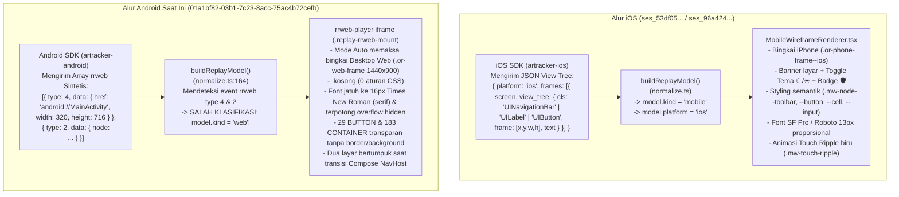

# Audit Data & UI Session Replay Android (`01a1bf82-03b1-7c23-8acc-75ac4b72cefb`) vs iOS

> **Dokumen**: Deep-Dive Data & UI/UX Forensic Audit + Remediation Plan  
> **Sesi yang Diaudit**: `01a1bf82-03b1-7c23-8acc-75ac4b72cefb` (`01a1bf8…2cefb`)  
> **Project**: `ai-mastery-android` (`project_id = 5`, platform: `android`)  
> **Pembanding**: `ai-mastery-ios` (`project_id = 4`, platform: `ios`, mis. `ses_53df05160b34b34a04a244be` & `ses_96a424fcc954c4efca281698`)  
> **Tanggal Audit**: 9 November 2026

---

## 1. Executive Summary

Berdasarkan pemeriksaan langsung terhadap baris database PostgreSQL (`replay_sessions`, `replay_chunks`, `telemetry_events`), dekompresi ke-3 file chunk gzip dari Cloudflare R2 (`projects/5/sessions/01a1bf82-03b1-7c23-8acc-75ac4b72cefb/chunk_1.gz` s/d `chunk_3.gz`), serta kode sumber frontend `artracker`, ditemukan bahwa **akar masalah utama mengapa tampilan replay Android terlihat rusak/jelek dan berbeda total dari iOS adalah perbedaan format payload chunk antara SDK Android dan SDK iOS, ditambah tidak adanya styling CSS pada DOM sintetis yang dikirim oleh SDK Android.**

Secara ringkas:
1. **SDK iOS (`artracker-ios`)** mengirim struktur pohon tampilan native (`view_tree` dengan nama class UIKit seperti `UINavigationBar`, `UITableView`, `UILabel`, `UIButton`, `UITextField`). Frontend merendernya menggunakan **`MobileWireframeRenderer`** di dalam bingkai iPhone yang bersih dengan tema wireframe terang/gelap, header nama layar, badge jumlah masking (`🛡️`), dan efek sentuhan (*touch ripple*).
2. **SDK Android (`artracker-android v0.1.0`)** pada sesi `01a1bf8…2cefb` **tidak** mengirim format `artracker-mobile-v1`, melainkan mengirim **array event `rrweb` sintetis** (`type: 4` Meta, `type: 2` FullSnapshot, `type: 3` IncrementalSnapshot) yang membungkus komponen Jetpack Compose menjadi tag HTML mentah (`<div>` dan `<span>` dengan atribut `data-artracker-type="CONTAINER|TEXT|BUTTON|IMAGE"`).
3. Karena payload tersebut berbentuk array `rrweb`, fungsi `buildReplayModel()` di frontend menganggap sesi Android ini sebagai **rekaman situs Web (`kind: 'web'`)**, sehingga:
   - Pada mode **`Auto`**, player menampilkan **bingkai browser desktop (`.or-web-frame`, resolusi `1440 × 900`)** untuk aplikasi Android berukuran `320 × 716`.
   - Konten dirender di dalam `<iframe>` milik `rrweb-player` **tanpa `<style>` sama sekali** (`<head>` kosong). Akibatnya, seluruh teks jatuh ke font default browser **`16px Times New Roman` (serif)** yang terpotong (*clipped*) oleh `overflow: hidden`, seluruh **29 tombol (`BUTTON`)** dan **kartu/navigasi (`CONTAINER`)** tampil transparan tanpa batas/warna, serta terjadi **tumpukan teks dua layar sekaligus (*ghosting*)** saat navigasi Jetpack Compose berlangsung.

---

## 2. Profil Data Nyata di Database & Cloudflare R2

### 2.1 Metadata Sesi di PostgreSQL (`replay_sessions`)

| Field | Nilai di Database (`01a1bf82-03b1-7c23-8acc-75ac4b72cefb`) | Tampilan di UI Session Queue |
| :--- | :--- | :--- |
| `id` | `01a1bf82-03b1-7c23-8acc-75ac4b72cefb` | `01a1bf8…2cefb` |
| `project_id` | `5` (`ai-mastery-android`, `platform = 'android'`) | Badge `Android` |
| `user_id` | `""` (kosong) | `anonymous_user` |
| `has_error` / `has_rage_click` / `has_dead_click` | `false` / `false` / `false` | Badge `clean` |
| `start_time` | `2026-11-09T15:52:15+07:00` | `2m ago` |
| `duration_ms` | `66969` (66,97 detik) | `01:07 duration` |
| `event_count` | `132` | `132 events` |
| `chunk_count` | `3` | `3 chunks` |

### 2.2 Rincian 3 Chunk di Cloudflare R2 (`replay_chunks`)

| Chunk | Object Key | Ukuran Gzip | Ukuran JSON | Jumlah Event | Rentang Timestamp (`ms`) | Isi Utama |
| :---: | :--- | ---: | ---: | :---: | :--- | :--- |
| **#1** | `.../chunk_1.gz` | `2.877 B` | `55.567 B` | `14` | `1794214370102` – `1794214384607` (`14,5s`) | 4× `Meta` (`type:4`), 4× `FullSnapshot` (`type:2`) untuk `android://MainActivity`, `android://skenario` (2×), `android://lab`; 6× mutasi/tap (`type:3`). |
| **#2** | `.../chunk_2.gz` | `3.715 B` | `34.303 B` | `100` | `1794214386389` – `1794214400942` (`14,5s`) | 1× `Meta` + 1× `FullSnapshot` (`android://lab/_id_`), 6× mutasi DOM (scroll list 500 baris, swipe pager `Halaman 1→3`, tap gesture arena), 92× event touch/drag (`source:2` & `source:6`). |
| **#3** | `.../chunk_3.gz` | `605 B` | `3.184 B` | `18` | `1794214400999` – `1794214402907` (`1,9s`) | 1× mutasi DOM (`drag (3)` & tambah teks `"Animasi (mati secara default)"`), 17× event koordinat touch/drag. |

### 2.3 Rincian 9 Event di `telemetry_events`

```text
[1] 15:52:46.434 | event | app_foreground | attrs={}
[2] 15:52:46.448 | event | screen_view    | attrs={"type": "activity", "screen": "MainActivity"}
[3] 15:52:50.621 | event | screen_view    | attrs={"type": "compose", "screen": "skenario", "previous": "MainActivity"}
[4] 15:53:04.012 | event | screen_view    | attrs={"type": "compose", "screen": "lab", "previous": "skenario"}
[5] 15:53:07.825 | event | screen_view    | attrs={"type": "compose", "screen": "lab/{id}", "previous": "lab"}
[6] 15:53:34.220 | event | app_background | attrs={}
[7] 15:53:46.054 | event | app_foreground | attrs={}
[8] 15:53:46.061 | event | screen_view    | attrs={"type": "activity", "screen": "MainActivity", "previous": "lab/{id}"}
[9] 15:56:25.722 | event | app_background | attrs={}
```

---

## 3. Perbandingan Arsitektur: Mengapa iOS Bagus sedangkan Android Jelek?



| Aspek Visual & Teknis | iOS Session Replay (`ai-mastery-ios`) | Android Session Replay (`01a1bf8…2cefb`) |
| :--- | :--- | :--- |
| **Format Payload Chunk** | Native View Hierarchy JSON (`frames[].view_tree` dengan `cls`, `frame`, `text`, `masked_count`) | Synthetic `rrweb` DOM (`type: 4, 2, 3` dengan `<div data-artracker-type="...">` & inline `left/top/width/height`) |
| **Hasil `buildReplayModel()`** | `{ kind: 'mobile', platform: 'ios' }` | `{ kind: 'web', events: [...] }` *(salah terdeteksi sebagai Web)* |
| **Komponen Renderer** | [`MobileWireframeRenderer.tsx`](file:///Users/tiofani/IdeaProjects/artracker/frontend/src/components/MobileWireframeRenderer.tsx) | `rrweb-player` (`<iframe>` via `.replay-rrweb-mount`) |
| **Bingkai Perangkat (Mode `Auto`)** | `.or-phone-frame--ios` (iPhone bezel + status bar jam + home indicator) | `.or-web-frame` (Jendela Browser Desktop dengan tombol merah/kuning/hijau Mac & chip `1440 × 900`) |
| **Header Dalam Layar** | `.mw-screen-banner` (Indikator titik aktif, nama layar bersih, tombol tema `☾`/`☀`, badge privasi `🛡️`) | Tidak ada banner; langsung merender `<body>` mentah |
| **Tipografi** | `-apple-system, "SF Pro Text", Roboto, sans-serif` ukuran `13px` dengan `text-overflow: ellipsis` | Default browser **`16px Times New Roman` (serif)** tanpa `white-space: nowrap`, sehingga teks terpotong tajam oleh `overflow: hidden` |
| **Visualisasi Tombol & Kartu** | Tombol berwarna aksen biru muda (`rgba(0,122,255,0.08)` + border `#007aff`), cell & toolbar memiliki background dan garis pemisah | **Tidak terlihat sama sekali** (`<div data-artracker-type="BUTTON">` hanya memiliki `position:absolute` tanpa warna/border) |
| **Transisi Antar Layar** | Pergantian `activeFrameAt()` menggantikan pohon layar lama secara bersih | Layar lama dan layar baru berada di DOM secara bersamaan selama ~2 detik dengan background transparan (**teks saling menimpa**) |

---

## 4. Rincian 7 Temuan Audit (Root Causes)

### Temuan #1 (Kritis): Salah Klasifikasi Platform di `buildReplayModel()` dan `ReplayPlayer.tsx`
- **Lokasi Kode**:
  - [`normalize.ts`](file:///Users/tiofani/IdeaProjects/artracker/frontend/src/replay/normalize.ts#L157-L186)
  - [`ReplayPlayer.tsx`](file:///Users/tiofani/IdeaProjects/artracker/frontend/src/components/ReplayPlayer.tsx#L200-L208)
- **Analisis**:
  Pada [`normalize.ts`](file:///Users/tiofani/IdeaProjects/artracker/frontend/src/replay/normalize.ts#L164-L166), fungsi `buildReplayModel()` mengecek `normalizeWebEvents(payloads.flatMap(rrwebEventsOf))` terlebih dahulu. Karena SDK Android mengirim event `rrweb` (`type: 4` dan `type: 2`), `buildReplayModel()` mengembalikan `model.kind === 'web'`.
  Selanjutnya, pada [`ReplayPlayer.tsx`](file:///Users/tiofani/IdeaProjects/artracker/frontend/src/components/ReplayPlayer.tsx#L200-L207):
  ```ts
  const effectivePlatform: DetectedPlatform =
    deviceMode !== 'auto'
      ? deviceMode
      : model.kind === 'mobile'
        ? model.platform
        : model.kind === 'web'
          ? 'web'
          : detection.platform
  ```
  Walaupun kartu **Session Queue** di sebelah kiri sudah benar menampilkan badge **`Android`** (karena `project.platform === 'android'`), dan walaupun event `Meta` (`type: 4`) di dalam chunk secara eksplisit memiliki `"href": "android://MainActivity"` serta ukuran portrait `"width": 320, "height": 716`, `effectivePlatform` dipaksa menjadi `'web'` saat `deviceMode === 'auto'`.
- **Dampak Visual**:
  - Aplikasi Android ditampilkan di dalam **bingkai Browser Desktop (`.or-web-frame`)** lengkap dengan lampu trafik macOS (merah-kuning-hijau) dan URL bar.
  - Badge resolusi di kanan atas menampilkan **`1440 × 900`** (desktop), bukan `320 × 716` atau `412 × 915`.
  - Kanvas portrait `320 × 716` diperkecil ke dalam panggung landscape `~860 × 484`, menghasilkan ruang kosong berwarna gelap (`--color-graphite`) yang sangat lebar di sisi kiri dan kanan.

---

### Temuan #2 (Kritis): DOM Sintetis Android Tidak Memiliki Stylesheet (`<head>` Kosong) — Font Serif & Elemen UI Transparan
- **Bukti Data Nyata (`chunk_1.gz` & `chunk_2.gz`)**:
  Di seluruh 5 `FullSnapshot` pada sesi `01a1bf8…2cefb`, elemen `<head>` (`id: 3`) kosong (`"childNodes": []`). Dari total **323 node DOM** yang terekam:
  - `data-artracker-type="CONTAINER"`: **183 node**
  - `data-artracker-type="TEXT"`: **110 node**
  - `data-artracker-type="BUTTON"`: **29 node**
  - `data-artracker-type="IMAGE"`: **1 node**

  Hanya **3 node** di seluruh aplikasi yang memiliki properti selain koordinat kotak (`position:absolute;left:Xpx;top:Ypx;width:Wpx;height:Hpx;overflow:hidden;`), yaitu:
  1. `div#11`: `background-color:#fafafa` (latar belakang dasar layar)
  2. `div#85` / `div#109`: `background-color:rgba(255,255,255,0.902)` (bar navigasi sistem bawah `320×44px`)
  3. `div#78`: `background-color:#cccccc` (kotak ikon tombol kembali `24×24px`)

- **Dampak Visual**:
  1. **Font Default `16px Times New Roman` & Teks Terpotong (*Clipped Text*)**:
     Tanpa `font-family` dan `font-size`, browser di dalam `<iframe>` `rrweb-player` menggunakan **`16px Times New Roman`**. Karena ukuran kotak (`width` & `height`) dihitung oleh Jetpack Compose menggunakan font sans-serif (Roboto) ukuran kecil (`11px–14px`), teks menjadi terlalu besar dan terpotong oleh `overflow: hidden`:
     - `span#19` (`"Status SDK: memuat…"`, `width: 112px; height: 15px; overflow: hidden`) — terbungkus menjadi 2 baris dan baris keduanya hilang terpotong.
     - `span#46` (`"Antrean & transport"`, `width: 129px; height: 7px; overflow: hidden`) — kotak setinggi `7px` memotong separuh bawah huruf `16px` sehingga tampak seperti garis rusak.
     - Label tombol chip `span#29` (`"EVENTS"`, `width: 47px`), `span#32` (`"SCREENS"`, `width: 56px`), `span#35` (`"MASKING"`, `width: 57px`) — huruf kapital serif `16px` melebihi lebar kotak sehingga huruf terakhirnya terpotong.
  2. **29 Tombol (`BUTTON`) Tidak Terlihat seperti Tombol**:
     Elemen seperti tombol `"Jalankan"` (`div#37`, `100×40px`), chip `"EVENTS"`, `"SCREENS"`, `"MASKING"`, `"IDENTITY"` memiliki atribut `data-artracker-type="BUTTON"`, tetapi **tidak memiliki `background-color`, `border`, maupun `border-radius`**. Di layar hanya tampak teks Times New Roman yang melayang di ruang kosong.
  3. **Kartu, AppBar, dan Bottom Navigation Bar Hilang**:
     - Kartu skenario (`"Checkout e-commerce"` `div#23`, `"Pendaftaran bertahap"` `div#40`, `"Event & log"` `div#25`, `"Privasi & masking"` `div#30`, `"Replay"` `div#35`, `"Jaringan"` `div#40`) tidak memiliki garis tepi (*border*) atau bayangan, sehingga menyatu dengan latar `#fafafa`.
     - **Bottom Navigation Bar** (`div#59` / `div#82` di `top: 592px; height: 124px` dengan menu `Skenario`, `Lab`, `Inspector`, `Pengaturan`) memiliki 4 kotak ikon `24×24px` (`div#65`, `div#71`, `div#77`, `div#83`) dan 4 kotak indikator pill `64×32px` (`div#66`, `div#72`, `div#78`, `div#84`) yang semuanya berupa `<div data-artracker-type="CONTAINER"></div>` kosong tanpa warna/ikon.

---

### Temuan #3 (Kritis): Dua Layar Bertumpuk (*Double-Screen Ghosting*) Saat Transisi Navigasi Jetpack Compose
- **Bukti Data Nyata (`chunk_1.gz` & `chunk_2.gz`)**:
  Saat pengguna berpindah layar di Jetpack Compose (`NavHost`), SDK Android langsung merekam `FullSnapshot` (`type: 2`) tepat ketika animasi *crossfade* transisi layar baru dimulai, di mana **layar lama yang sedang keluar (*exiting*) dan layar baru yang sedang masuk (*entering*) masih sama-sama berada di pohon semantik pada koordinat yang persis sama (`left: 0px; top: 160px; width: 320px; height: 432px`)**:
  - **Transisi 1 (`chunk_1` event `[12]`, `ts = 1794214384360`, `href = "android://lab"`)**:
    Di dalam `div#16`, terdapat dua container halaman utama sekaligus:
    - `div#21` (`top: 160px, 320×432px`): Berisi layar lama **`skenario`** (`"Checkout e-commerce"`, `"Beranda, pencarian, produk..."`, `"EVENTS"`, `"SCREENS"`, `"MASKING"`, `"Jalankan"`, `"Pendaftaran bertahap"`).
    - `div#54` (`top: 160px, 320×432px`): Berisi layar baru **`lab`** (`"Lab per kapabilitas"`, `"Event & log"`, `"Privasi & masking"`, `"Replay"`, `"Jaringan"`).
    Karena `div#54` memiliki background transparan, seluruh teks layar `lab` tercetak **menimpa** teks layar `skenario` selama **2,03 detik** (hingga `chunk_2` event `[0]` pada `ts = 1794214386389` mengirim mutasi `removes: [{"parentId": 16, "id": 21}]`).
  - **Transisi 2 (`chunk_2` event `[5]`, `ts = 1794214388970`, `href = "android://lab/_id_"`)**:
    Di dalam `div#16`, kembali terdapat dua container halaman sekaligus di `[0, 160, 320, 432]`:
    - `div#21`: Berisi layar **`lab`** (`"Lab per kapabilitas"`, `"Event & log"`, `"Privasi & masking"`, `"Replay"`).
    - `div#48`: Berisi layar **`lab/{id}`** (`"Kontrol replay"`, `"Niat replay: ON"`, `"Mulai replay"`, `"Hentikan replay"`, `"Daftar panjang (500 baris)"`).
    Kedua layar kembali saling menimpa selama **2,03 detik** hingga `ts = 1794214391001`.
  - **Transisi 3 (`chunk_2` event `[68]`, `ts = 1794214397106`, `HorizontalPager`)**:
    Di dalam container pager `div#128`, `div#134` (`"Halaman 2"`) dan `div#137` (`"Halaman 3"`) ditambahkan bersamaan di `top: 0px` dengan background transparan hingga `ts = 1794214399131`.

---

### Temuan #4 (Mayor): Ketidakcocokan Geometri & Letterboxing saat Mode `Android` Dipilih Manual
- **Lokasi Kode**:
  - [`ReplayPlayer.tsx`](file:///Users/tiofani/IdeaProjects/artracker/frontend/src/components/ReplayPlayer.tsx#L223-L229)
  - [`dashboard.css`](file:///Users/tiofani/IdeaProjects/artracker/frontend/src/dashboard.css#L1986-L2006)
  - [`dashboard.css`](file:///Users/tiofani/IdeaProjects/artracker/frontend/src/dashboard.css#L2423-L2435)
- **Analisis**:
  Jika pengguna menekan tombol **`Android`** pada switcher viewport di header player:
  1. `.or-phone-frame--android` memiliki `width: 320px; height: 560px; border: 6px solid var(--color-paper-3); box-sizing: border-box`. Lebar bersih di dalam border adalah `320 - 12 = 308px`, dan tinggi bersih di antara `.or-phone-statusbar` (`30px`) dan `.or-phone-homebar` (`16px`) adalah `560 - 12 - 30 - 16 = 502px`.
  2. Namun [`ReplayPlayer.tsx`](file:///Users/tiofani/IdeaProjects/artracker/frontend/src/components/ReplayPlayer.tsx#L223-L229) memberikan `playerWidth = 312` (`4px` lebih lebar dari ruang dalam `308px`) dan `playerHeight = 500` ke `rrweb-player`.
  3. Karena ukuran dokumen di dalam chunk Android adalah `320 × 716` (rasio `0,4469`), `rrweb-player` melakukan *fit-to-height* dengan skala `500 / 716 = 0,6983`, menghasilkan lebar iframe ter-skala sebesar **`223px × 500px`** di tengah wadah selebar `308px`.
  4. Karena `.replay-rrweb-mount` dan `.rr-player` di [`dashboard.css`](file:///Users/tiofani/IdeaProjects/artracker/frontend/src/dashboard.css#L2423-L2435) dipaksa berwarna gelap (`background: var(--color-graphite)`), muncul **dua blok hitam/grafit selebar `42,5px` di kiri dan kanan** di dalam layar ponsel Android yang berlatar putih `#fafafa`!

---

### Temuan #5 (Mayor): Route Strip Statis & Label `URL` yang Tidak Sesuai Konteks Mobile
- **Lokasi Kode**:
  - [`ReplayPlayer.tsx`](file:///Users/tiofani/IdeaProjects/artracker/frontend/src/components/ReplayPlayer.tsx#L258-L281)
  - [`playback.ts`](file:///Users/tiofani/IdeaProjects/artracker/frontend/src/replay/playback.ts#L54-L62)
- **Analisis**:
  - `recordedUrl` di [`ReplayPlayer.tsx`](file:///Users/tiofani/IdeaProjects/artracker/frontend/src/components/ReplayPlayer.tsx#L258-L263) hanya melakukan `return` pada `EventType.Meta` **pertama** (`android://MainActivity`), tanpa memperhatikan posisi waktu putar (`currentTimeMs`).
  - Padahal di dalam chunk, SDK Android mengirim event `EventType.Meta` baru setiap kali layar berpindah:
    - `00:00` (`1794214370102`): `android://MainActivity`
    - `00:00.3` (`1794214370458`): `android://skenario`
    - `00:14.2` (`1794214384360`): `android://lab`
    - `00:18.8` (`1794214388970`): `android://lab/_id_`
  - Akibatnya, bar lokasi di atas player tidak pernah berubah mengikuti layar aktif saat video diputar atau di-*scrub*.

---

### Temuan #6 (Menengah): Selisih Durasi (`01:07` di Queue vs `00:32` di Player) & Penempatan Marker Timeline
- **Lokasi Kode**:
  - [`ReplayPlayer.tsx`](file:///Users/tiofani/IdeaProjects/artracker/frontend/src/components/ReplayPlayer.tsx#L231-L240)
  - [`ReplayPlayer.tsx`](file:///Users/tiofani/IdeaProjects/artracker/frontend/src/components/ReplayPlayer.tsx#L302-L333)
- **Analisis**:
  1. **Durasi Sesi vs Durasi Chunk**:
     Di kartu Session Queue, durasi diambil dari `replay_sessions.duration_ms` (`66.969 ms` $\rightarrow$ **`01:07 duration`**). Namun saat sesi dibuka, `ReplayPlayer` menghitung `durationMs = model.endMs - model.startMs` dari chunk (`1794214402907 - 1794214370102 = 32.805 ms` $\rightarrow$ **`00:32`**). Hal ini terjadi karena aplikasi sempat berada di background / aktif sebelum dan sesudah perekaman chunk (`15:52:15` s/d `15:53:51`), sedangkan chunk hanya mencakup detik `15:52:50` s/d `15:53:22`.
  2. **Distorsi Posisi Titik Marker di Scrubber**:
     Pada [`ReplayPlayer.tsx`](file:///Users/tiofani/IdeaProjects/artracker/frontend/src/components/ReplayPlayer.tsx#L307-L314):
     - Event telemetri `[1]` (`app_foreground`, `15:52:46.434`) dan `[2]` (`screen_view MainActivity`, `15:52:46.448`) memiliki timestamp **3,6 detik lebih awal** dari `baseTimestampMs` chunk pertama (`15:52:50.102`). Karena `evTs < baseTimestampMs`, kode masuk ke cabang `else`:
       ```ts
       offsetMs = Math.round(((idx + 1) / (timelineEvents.length + 1)) * durationMs)
       ```
       yang meletakkan event awal sesi secara keliru di tengah timeline (`10%` dan `20%`)!
     - Sebaliknya, event `[6]` s/d `[9]` (`15:53:34` s/d `15:56:25`) terjadi setelah chunk ke-3 selesai, sehingga semuanya di-*clamp* menumpuk di satu titik `99%` (`00:32`).

---

### Temuan #7 (Minor): Bug CSS pada Kartu Session Queue & Kompatibilitas Chunk iOS Tanpa Field `format`
1. **Titik Status `clean` Tidak Muncul di Session Queue**:
   - Pada [`DashboardPage.tsx`](file:///Users/tiofani/IdeaProjects/artracker/frontend/src/pages/DashboardPage.tsx#L1255), sesi tanpa error diberi class `dash-session-item__dot--clean`.
   - Pada [`dashboard.css`](file:///Users/tiofani/IdeaProjects/artracker/frontend/src/dashboard.css#L1265-L1268):
     ```css
     .dash-session-item__dot--clean {
       background: var(--color-active);
       box-shadow: 0 0 0 2px var(--color-active-wash);
     }
     ```
   - Variabel `--color-active` dan `--color-active-wash` **tidak pernah didefinisikan** di [`tokens.css`](file:///Users/tiofani/IdeaProjects/artracker/frontend/src/tokens.css) (yang ada adalah `--color-success` dan `--color-success-wash`). Akibatnya, bulatan indikator status di kiri nama `anonymous_user` menjadi transparan/hilang.
2. **Duplikasi & Kontras Badge `.dash-session-item__platform`**:
   - Didefinisikan dua kali di [`dashboard.css`](file:///Users/tiofani/IdeaProjects/artracker/frontend/src/dashboard.css#L1280-L1291) dan [`dashboard.css`](file:///Users/tiofani/IdeaProjects/artracker/frontend/src/dashboard.css#L1734-L1745) dengan `background: rgba(255, 255, 255, 0.06); border: 1px solid rgba(255, 255, 255, 0.08);` yang membuat border badge `Android` / `iOS` lenyap di atas kartu putih pada mode terang (*light theme*).
3. **Chunk iOS Lama Tanpa Field `"format": "artracker-mobile-v1"`**:
   - Pada [`normalize.ts`](file:///Users/tiofani/IdeaProjects/artracker/frontend/src/replay/normalize.ts#L109), `extractMobileFrames()` menolak payload jika `p.format !== 'artracker-mobile-v1'`. Padahal di database (`ses_53df05160b34b34a04a244be` chunk 0–1 dan `ses_96a424fcc954c4efca281698` chunk 0–2), objek JSON memiliki `{ "platform": "ios", "frames": [...], "touches": [...] }` tanpa properti `"format"`.

---

## 5. Rencana Perbaikan Terpisah: Web Dashboard vs Android SDK

Rencana implementasi telah dipisahkan menjadi **2 dokumen plan mandiri** sesuai tanggung jawab repositori masing-masing:

1. 🌐 **[Plan Web Dashboard (`docs/plan-web.md`)](file:///Users/tiofani/IdeaProjects/artracker/docs/plan-web.md)** — Untuk repositori **`artracker/frontend`** (dapat dikerjakan sekarang juga dan **langsung memperbaiki tampilan sesi `01a1bf8…2cefb` yang sudah tersimpan di R2** tanpa menunggu rilis SDK baru).
2. 🤖 **[Plan Android SDK (`docs/plan-android.md`)](file:///Users/tiofani/IdeaProjects/artracker/docs/plan-android.md)** — Untuk repositori **`artracker-android`** (memperbaiki perekaman `FullSnapshot` saat transisi Jetpack Compose, penyertaan stylesheet/ukuran font dari `TextLayoutResult`, atribut semantik komponen, dan sinkronisasi durasi sesi untuk perekaman baru).

---

### 5.1 Ringkasan Plan Web Dashboard (`artracker/frontend`)
> 📄 **Detail teknis & kode lengkap**: Lihat **[`docs/plan-web.md`](file:///Users/tiofani/IdeaProjects/artracker/docs/plan-web.md)**

| Kode | Area Perbaikan di Web (`frontend/`) | File Target |
| :--- | :--- | :--- |
| **WEB-01** | **Deteksi Platform `android://` pada Stream `rrweb`**: Tambahkan `inferredPlatform: 'android' \| 'ios'` dan `viewport: { width, height }` pada `ReplayModel` (`kind: 'web'`) dari event `Meta` (`type: 4`) agar mode **`Auto`** langsung memakai bingkai ponsel **`.or-phone-frame--android`** dan menampilkan resolusi asli **`320 × 716`** (bukan Desktop Browser `1440 × 900`). | [`frontend/src/replay/normalize.ts`](file:///Users/tiofani/IdeaProjects/artracker/frontend/src/replay/normalize.ts)<br>[`frontend/src/components/ReplayPlayer.tsx`](file:///Users/tiofani/IdeaProjects/artracker/frontend/src/components/ReplayPlayer.tsx) |
| **WEB-02** | **Injeksi Wireframe Stylesheet ke `<head>` Snapshot Android**: Sisipkan `<style>` otomatis pada snapshot yang memiliki `data-artracker-type` (font `Roboto` sans-serif `11px`, `white-space: nowrap`, `overflow: visible` pada `TEXT`, background & border biru pada `BUTTON`, serta styling kartu/toolbar/bottom-nav pada `CONTAINER`). | [`frontend/src/replay/normalize.ts`](file:///Users/tiofani/IdeaProjects/artracker/frontend/src/replay/normalize.ts) |
| **WEB-03** | **Sanitisasi *Double-Screen Ghosting* pada Transisi Compose**: Deteksi dua sibling `CONTAINER` layar utama yang bertumpuk pada koordinat identik (`[0, 160, 320, 432]`, mis. `div#21` dan `div#54`/`div#48`) di dalam `FullSnapshot`, sembunyikan layar lama (`exiting`), dan beri background `#fafafa` opaque pada layar baru (`entering`). | [`frontend/src/replay/normalize.ts`](file:///Users/tiofani/IdeaProjects/artracker/frontend/src/replay/normalize.ts) |
| **WEB-04** | **Perbaikan Proporsi Viewport `.or-phone-frame--android` & Penghapusan Letterboxing Hitam**: Sesuaikan dimensi ruang dalam bingkai ponsel Android dengan rasio `320 × 716` dan ubah latar `.or-phone-frame .replay-rrweb-mount` menjadi `#fafafa` (bukan `--color-graphite` hitam). | [`frontend/src/components/ReplayPlayer.tsx`](file:///Users/tiofani/IdeaProjects/artracker/frontend/src/components/ReplayPlayer.tsx)<br>[`frontend/src/dashboard.css`](file:///Users/tiofani/IdeaProjects/artracker/frontend/src/dashboard.css) |
| **WEB-05** | **Route / Screen Strip Dinamis (`recordedUrl`)**: Perbarui `recordedUrl` mengikuti event `EventType.Meta` terakhir pada posisi `currentTimeMs` (`MainActivity` $\rightarrow$ `skenario` $\rightarrow$ `lab` $\rightarrow$ `lab/{id}`) dan ubah label menjadi `SCREEN` untuk sesi mobile. | [`frontend/src/components/ReplayPlayer.tsx`](file:///Users/tiofani/IdeaProjects/artracker/frontend/src/components/ReplayPlayer.tsx) |
| **WEB-06** | **Perbaikan Posisi Marker Timeline**: Clamp event telemetri yang memiliki timestamp sedikit sebelum `baseTimestampMs` chunk pertama ke `0%` (jangan masuk ke fallback proporsional `10%`, `20%`). | [`frontend/src/components/ReplayPlayer.tsx`](file:///Users/tiofani/IdeaProjects/artracker/frontend/src/components/ReplayPlayer.tsx) |
| **WEB-07** | **Perbaikan CSS Session Queue & Chunk iOS Tanpa `format`**: Ganti `--color-active` yang tidak terdefinisi pada `.dash-session-item__dot--clean` menjadi `--color-success`, rapikan kontras `.dash-session-item__platform`, dan izinkan chunk iOS tanpa properti `format` di `extractMobileFrames()`. | [`frontend/src/dashboard.css`](file:///Users/tiofani/IdeaProjects/artracker/frontend/src/dashboard.css)<br>[`frontend/src/replay/normalize.ts`](file:///Users/tiofani/IdeaProjects/artracker/frontend/src/replay/normalize.ts) |

---

### 5.2 Ringkasan Plan Android SDK (`artracker-android`)
> 📄 **Detail teknis & panduan Kotlin/Compose lengkap**: Lihat **[`docs/plan-android.md`](file:///Users/tiofani/IdeaProjects/artracker/docs/plan-android.md)**

| Kode | Area Perbaikan di Android SDK (`artracker-android`) | Komponen SDK Target |
| :--- | :--- | :--- |
| **AND-01** | **Cegah `FullSnapshot` di Tengah Transisi `NavHost` (*Mid-Transition*)**: Tunda pengambilan `FullSnapshot` hingga transisi `NavHost` selesai (atau filter hanya subtree destination `entering` paling atas) dan jadwalkan diff mutasi ekstra pada `+400ms` pasca-navigasi agar dua layar tidak terekam bertumpuk. | Compose Navigation / Snapshot Trigger |
| **AND-02** | **Sertakan Default `<style>` di Dalam `<head>` Snapshot `rrweb`**: Sisipkan aturan CSS dasar untuk `[data-artracker-type]` di setiap `FullSnapshot` (`id: 3` `<head>`) agar DOM sintetis Android memiliki font sans-serif, tombol, kartu, dan warna latar yang valid sejak dari sumbernya. | `rrweb` DOM Serializer |
| **AND-03** | **Ekstraksi Ukuran Font dari `TextLayoutResult` & Aturan Clipping**: Ambil `fontSize`, `fontWeight`, dan `color` dari `SemanticsActions.GetTextLayoutResult`, serta pasang `overflow: hidden` hanya pada container scroll (`SCROLL_CONTAINER`), bukan pada `<span data-artracker-type="TEXT">` berukuran tinggi kecil (`7px–15px`). | Compose `SemanticsNode` Mapper |
| **AND-04** | **Perkaya Atribut Semantik (`CARD`, `TAB`, `INPUT`, `ICON`, `data-artracker-masked`)**: Bedakan `Role.Tab` (`data-artracker-selected`), `Role.Image` (`data-artracker-label`), container scroll, permukaan kartu (`Card`/`Surface`), dan elemen yang terkena masking PII (`data-artracker-masked="true"`). | Compose / View Semantics Serializer |
| **AND-05** | **Sinkronisasi URI Route (`lab/{id}`) & `duration_ms` Sesi**: Pertahankan nama route asli di `Meta.data.href` tanpa mengubah `{id}` menjadi `_id_`, dan selaraskan perhitungan `duration_ms` sesi dengan rentang waktu chunk yang direkam. | Session Manager & Navigation Tracker |

---

## 6. Ringkasan File yang Terkait

| File | Peran dalam Temuan Audit |
| :--- | :--- |
| [`frontend/src/replay/normalize.ts`](file:///Users/tiofani/IdeaProjects/artracker/frontend/src/replay/normalize.ts#L100-L186) | Mengklasifikasikan chunk `rrweb` Android sebagai `kind: 'web'` dan menolak chunk mobile tanpa field `format: 'artracker-mobile-v1'`. |
| [`frontend/src/components/ReplayPlayer.tsx`](file:///Users/tiofani/IdeaProjects/artracker/frontend/src/components/ReplayPlayer.tsx#L200-L333) | Menentukan `effectivePlatform`, ukuran `playerWidth`/`playerHeight`, `recordedUrl` statis, dan kalkulasi posisi marker timeline. |
| [`frontend/src/components/MobileWireframeRenderer.tsx`](file:///Users/tiofani/IdeaProjects/artracker/frontend/src/components/MobileWireframeRenderer.tsx#L51-L258) | Renderer wireframe native yang saat ini hanya dipakai oleh iOS (`kind: 'mobile'`). |
| [`frontend/src/dashboard.css`](file:///Users/tiofani/IdeaProjects/artracker/frontend/src/dashboard.css#L1248-L1291) | Bug variabel `--color-active` yang tidak terdefinisi pada `.dash-session-item__dot--clean`, badge platform transparan di light mode, dan latar `--color-graphite` pada `.replay-rrweb-mount`. |
| [`frontend/src/pages/DashboardPage.tsx`](file:///Users/tiofani/IdeaProjects/artracker/frontend/src/pages/DashboardPage.tsx#L1234-L1302) | Komponen daftar **Session Queue** di kolom kiri halaman Session Replay. |
